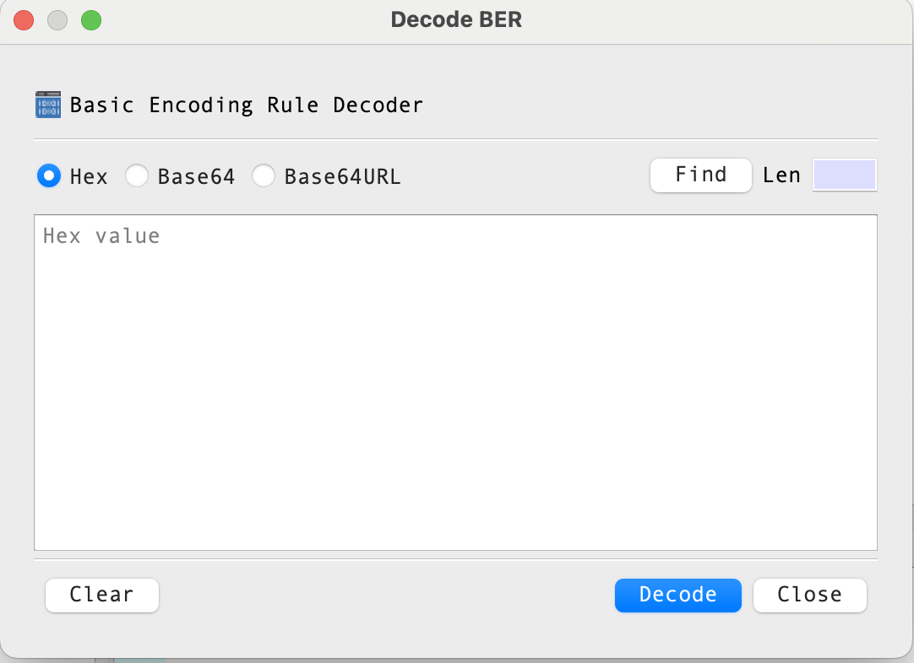

# Viewing ASN.1 BER/DER Data with BerEditor

BerEditor can decode ASN.1 data encoded with BER or DER and display its structure and values. This is useful when examining X.509 certificates, certificate revocation lists (CRLs), private keys, and other ASN.1-based data.

This guide is adapted from the [original BerEditor article](https://jykim74.tistory.com/115). The screenshots below use the corresponding images included with this project.

## Ways to load encoded data

BerEditor provides several ways to open data:

1. Open a file from the **File > Open** menu.
2. Paste hexadecimal or Base64 data into the BER decoder.
3. Drag and drop a BER/DER binary or PEM file into the application.
4. Retrieve data from a URI using **Tool > Get BER from URI**.

### Open a file

Choose **File > Open**, then select a BER or DER binary file. PEM-encoded files can also be opened; BerEditor recognizes common input encodings automatically.

### Enter BER data directly

Choose **Tool > Decode BER** and enter the data as hexadecimal or Base64 text. The example below shows the decoder dialog with hexadecimal input.

### Drag and drop a file

You can also drag a BER/DER binary file or a PEM file from your file manager and drop it into BerEditor. The decoded data opens in the main viewer.

### Retrieve data from a URI

Choose **Tool > Get BER from URI** to retrieve encoded data from a network address. For HTTP, BerEditor issues a GET request and treats the response body as binary data. For LDAP, it connects to the LDAP address and retrieves data using the specified filter and data type.

## Reading the decoded data

The viewer organizes decoded data into three main areas:

- **BER tree:** the hierarchical ASN.1 structure.
- **Hex view:** the encoded bytes, with multiple display modes.
- **Selected-item details:** information about the node selected in the BER tree.

BerEditor detects common input forms such as binary BER/DER, PEM, and Base64. The right-hand pane also provides tabs for viewing data as **Hex**, **XML**, **Text**, and **JSON**.

## Summary

Use file opening, direct data entry, drag and drop, or URI retrieval to load BER/DER data. Then navigate the tree, inspect the encoded bytes, and use the alternate views to understand the decoded structure.

