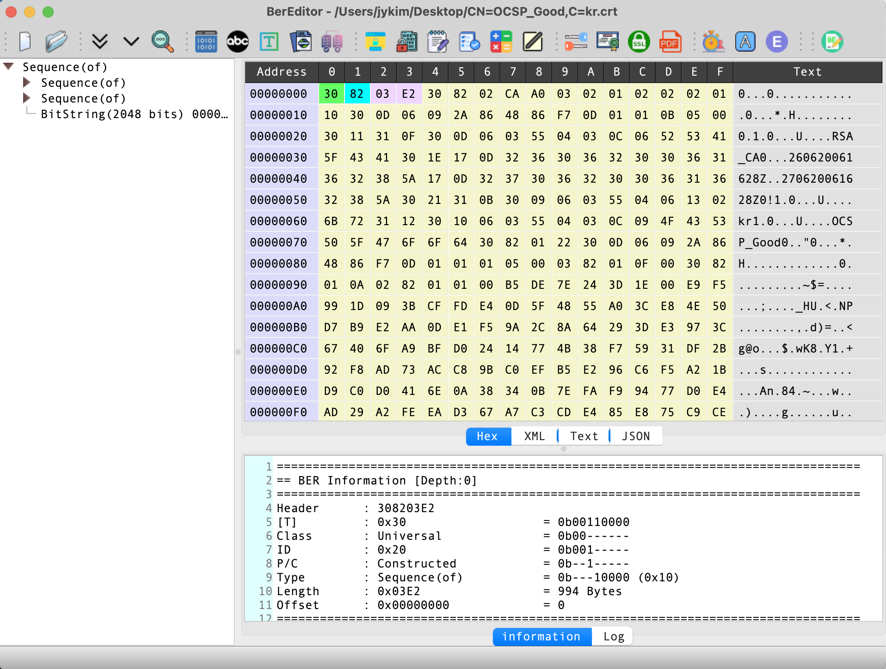

# BerEditor: ASN.1, BER/DER, and KMIP TTLV Workbench

BerEditor is a desktop utility for inspecting and working with encoded data used in ASN.1-based protocols and Public Key Infrastructure (PKI). Its main window presents BER data as a navigable structure, while related tools support data conversion, certificate and key operations, cryptographic tasks, and KMIP TTLV messages.

This overview follows the feature set described by the BerEditor project page and the application menus and implementations in the source code. Menu availability can depend on the installed license.

## Main window

The main window is the starting point for opening and navigating encoded data. The screenshot below shows the BerEditor interface with a decoded structure displayed in the central view.

## What BerEditor is for

ASN.1 defines data types and structures; BER (Basic Encoding Rules) and DER (Distinguished Encoding Rules) encode those structures as bytes. The bytes themselves can be difficult to interpret by eye. BerEditor decodes supported BER/DER data into a tree so that the structure and values can be examined, and provides tools to create, edit, compare, and validate encoded data.

The application also recognizes KMIP TTLV (Tag, Type, Length, Value), the message encoding used by the Key Management Interoperability Protocol. TTLV has its own tree and tools in BerEditor; it is related to the application's data-inspection workflow but is not BER or DER.

## Main capabilities

### Inspect and edit BER/DER

Open BER-encoded files and inspect their nodes in the main tree view. Selecting a node lets you work with its value and encoded data. The application includes commands to decode BER, create BER, check BER data, compare two BER values, and retrieve BER data from a URI. BER editing and several auxiliary viewing tabs are license-controlled.

For common PKI objects, the application offers dedicated views and tools for certificates, certificate signing requests (CSRs), certificate revocation lists (CRLs), keys, and CMS/PKCS#7 data. Dedicated information dialogs expose fields in a more meaningful form than raw bytes alone.

### Work with alternate data representations

The tool menu includes a data converter for encoding or converting input data, a BER decoding tool, a BER construction tool, and a numeric converter. Depending on the selected data and license, BerEditor also provides XML, text, and log views alongside the structured representation. These views are useful when investigating how an encoded object relates to readable or application-level data.

### Inspect ASN.1 object identifiers

The OID Information tool looks up object identifier values used in ASN.1, certificates, and cryptographic formats. This helps identify algorithm, extension, and attribute identifiers encountered while inspecting PKI data.

### Use KMIP TTLV tools

The KMIP menu provides separate functions to decode TTLV, create TTLV, encode TTLV, and interact with a KMIP server through the TTLV client. Decoded TTLV data is shown as a structured tree, making nested request and response messages easier to inspect. The source also detects TTLV input and can offer to open it in the TTLV view; TTLV decoding requires a license.

### PKI and cryptographic utilities

BerEditor groups cryptographic operations and certificate-related tools in its Cryptogram and Service menus. The source includes workflows for key generation and management, certificate and CSR handling, signing and verification, encryption and decryption, hashing and MAC generation, OTP generation, and big-number calculations. Other certificate utilities include certificate path validation and X.509 comparison. An SSL Check tool inspects SSL/TLS connections or protocol support, and an ACME client is available for certificate automation workflows.

These are practical tools for development and troubleshooting. Their presence does not by itself establish that a particular certificate, key, connection, or cryptographic configuration is secure; results depend on the supplied data, configuration, and validation context.

## Typical workflows

### Examine an encoded object

1. Open a BER/DER file in BerEditor.
2. Expand the tree to navigate through the ASN.1 structure.
3. Select a node to inspect its value or encoded bytes.
4. Use the relevant information dialog, OID lookup, or alternate view to interpret the fields.
5. If needed, compare the data with another BER object or run the BER check tool.

### Construct or convert data

Use the data converter when starting with input that should be encoded, and the BER creation tool when assembling BER data. Decode the resulting bytes in the main viewer to inspect their structure. Available operations and editing controls may depend on the license.

### Inspect a KMIP message

Open a TTLV message with the TTLV decoder or use the KMIP client/encoder workflow. Navigate the decoded Tag, Type, Length, and Value items in the TTLV tree, then use the encoder or client tool as appropriate for the next step.

### Review PKI material

Open a certificate, CSR, CRL, or key in the corresponding BerEditor workflow. Use the dedicated information dialogs for its fields, OID Information for identifiers, Certificate Path Validation for a chain-validation task, and X.509 Compare to compare certificates. Use signing, verification, encryption, or decryption tools when the task requires those operations.

## Licensing

The project page identifies the following as available in both licensed and unlicensed editions: BER/DER viewing, data encoding, the numeric converter, and OID information. It lists XML, text, and log tabs; cryptographic menu functions; BER editing; SSL Check; Certificate Path Validation; KMIP TTLV; X.509 Compare; and the ACME client as licensed-edition features. Exact feature availability should be confirmed against the version and license in use.

## Platforms, downloads, and support

The project page lists installers or packages for Windows 64-bit, macOS, and Linux 64-bit. The links below are the version 2.9.8 downloads listed on that page:

- [BerEditor 2.9.8 for Windows 64-bit](https://jykim74.github.io/msi/BerEditor-enV298.msi)
- [BerEditor 2.9.8 for macOS](https://jykim74.github.io/dmg/BerEditorV298.dmg)
- [BerEditor 2.9.8 for Linux 64-bit](https://jykim74.github.io/zip/BerEditorV298.zip)

The project page describes the download size as approximately 35 MB; actual size may vary by platform and release. Check the project page for newer releases.

