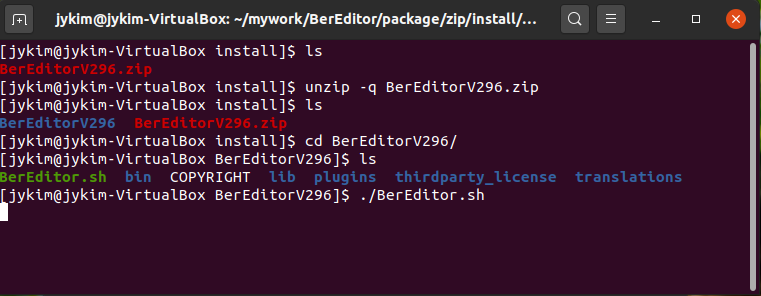

# Install BerEditor on Linux

The Linux download is a ZIP archive. The screenshot below shows the terminal commands used to extract the archive and start BerEditor.



## Install and launch

1. Download the Linux ZIP package, `BerEditorV296.zip`, and open a terminal in the directory where it was saved.
2. Extract the archive:

   ```sh
   unzip -q BerEditorV296.zip
   ```

3. Change to the extracted application directory:

   ```sh
   cd BerEditorV296
   ```

4. Start BerEditor:

   ```sh
   ./BerEditor.sh
   ```

The archive name and extracted directory shown above include a specific release version. They may change between releases. Replace `BerEditorV296.zip` and `BerEditorV296` in the commands with the actual archive filename and directory name for the version you downloaded. If the archive is saved elsewhere, use its actual path as well.
