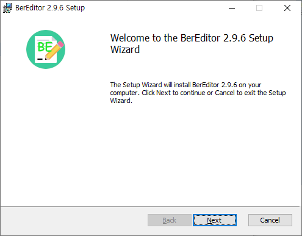
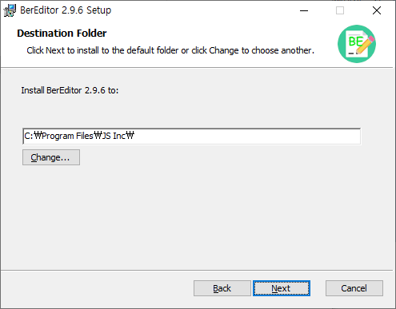
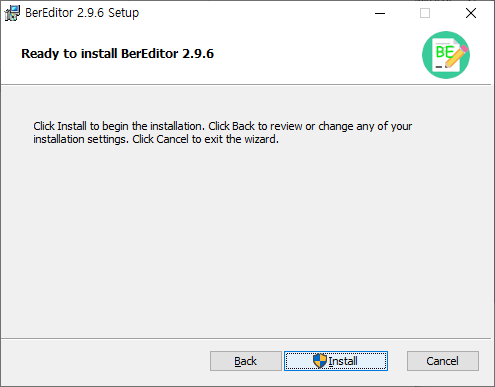
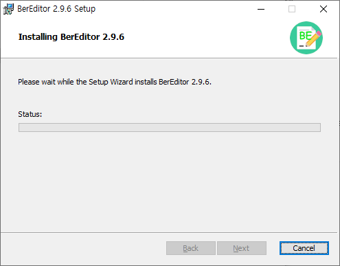
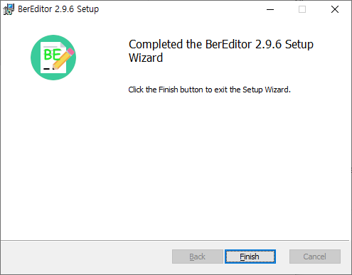

# Install BerEditor on Windows

The Windows installer uses a setup wizard. The screenshots below show the installation flow for BerEditor 2.9.6.

## Install BerEditor

1. Download and run the BerEditor Windows installer (`.msi`). The setup wizard opens with a welcome page. Select **Next**.

   

2. Review the destination folder. Keep the default location or select **Change...** to choose another folder, then select **Next**.

   

3. On the ready-to-install page, select **Install** to begin.

   

4. Wait while the setup wizard installs BerEditor.

   

5. When setup is complete, select **Finish** to close the wizard.

   

The screenshots show version 2.9.6. Installer filenames and version numbers may differ in later releases; use the installer for the version you downloaded.
