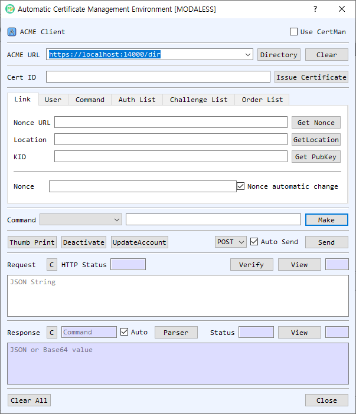

# ACME Client Dialog Guide

The **ACME Client** communicates with an ACME directory to manage an account, create certificate orders, complete authorizations, and retrieve issued certificates. It exposes individual ACME commands and a guided **Issue Certificate** workflow.

*Figure 1. ACME Client dialog. Retrieve the directory first to populate endpoint commands, then build and send requests while parsing server responses.*

## Screen Areas

1. **Use CertMan** — Select whether the ACME account key comes from CertMan or KeyPairMan. The client supports RSA, ECDSA, and EdDSA account keys.
2. **ACME URL / Directory / Clear** — Enter the ACME directory URL and select **Directory** to retrieve its endpoint map. The command selector is populated from the directory response. **Clear** clears saved URL entries.
3. **Cert ID / Issue Certificate** — **Cert ID** identifies a certificate for applicable commands. **Issue Certificate** runs the guided account, order, authorization, challenge, finalize, and certificate retrieval sequence, prompting before each step.
4. **Link tab** — Contains **Nonce URL**, **Location**, and **KID**. **Get Nonce** fetches a Replay-Nonce; **GetLocation** retrieves the selected resource; **Get PubKey** loads the account key's public-key identifier. **Nonce automatic change** allows the nonce to be refreshed during command processing.
5. **User tab** — Enter the account **Email** and add DNS identifiers to the **DNS** list. **DNS Check** opens DNS checking for the listed names. **Add** and **Clear** manage the identifier list. **ChallTest** opens the challenge test utility.
6. **Command tab** — Select an ACME command, enter or confirm its endpoint URL, and choose **Make** to create the signed JSON request. The hash selection is used with the account key.
7. **Auth List / Challenge List / Order List** — Display parsed authorizations, challenges, and orders. Their context menus provide available row operations, including removal or rebuilding where supported.
8. **Method / Auto Send / Send** — Choose **POST** or **GET**. **Auto Send** transmits a generated request automatically; otherwise use **Send** manually.
9. **Thumb Print / Deactivate / UpdateAccount** — Run account/key actions for the selected ACME context.
10. **Request** — Displays the JSON/JWS request. **Verify** checks its JWS signature; **View** opens the JSON structure; **C** clears it. **HTTP Status** shows the response status associated with the request exchange.
11. **Response / Parser / Auto / Status** — Displays the server's JSON or Base64 response. **Parser** interprets the response and updates command, authorization, challenge, or order lists. **Auto** parses responses automatically. **View** inspects the response structure; **C** clears it.
12. **Clear All / Close** — Clear the current ACME state or close the dialog.

## Start an ACME Session

1. Enter the ACME directory URL and select **Directory**. The directory endpoints and nonce URL are loaded into the command controls.
2. Select an account key source with **Use CertMan**. The first signed request prompts for the account key pair or certificate/key from the selected manager.
3. Select **Get Nonce** or leave **Nonce automatic change** enabled to manage nonces during requests.
4. Enter the account email in the **User** tab and add the DNS identifier to the list.
5. Choose a command and review the endpoint URL. Select **Make** to build the signed request. With **Auto Send** enabled, it is sent immediately.
6. Review the HTTP status and response. Keep **Auto** enabled or select **Parser** to extract endpoint links and populate the command, authorization, challenge, and order lists.

## Issue a Certificate

1. Retrieve the directory and nonce, enter the account email, and add one DNS name. The guided workflow currently supports one DNS identifier at a time.
2. Select **Issue Certificate** and confirm each prompted command. The workflow creates an account and order, processes authorization and challenge steps, finalizes the order, fetches the order/certificate, and displays the returned certificate chain.
3. Complete the DNS or HTTP challenge with the validation data required by the ACME server. Use **DNS Check** or **ChallTest** where appropriate; this dialog does not make control of the domain automatic.
4. When prompted, save the issued certificate and private key to CertMan.

## Command and Response Handling

- **Directory** fetches the server's directory object and fills the endpoint list.
- **Make** constructs the request for the selected command; **Send** transmits it using the selected HTTP method.
- **Parser** reads the response status and detail, then adds links for related operations such as finalize, authorization, orders, and certificate retrieval.
- **GetLocation** retrieves a resource URL; **UpdateAccount** and **Deactivate** run the corresponding account commands.
- Right-click rows in the command, authorization, challenge, or order lists for supported row actions.

## Notes

- ACME requires a reachable directory endpoint, valid account credentials, fresh replay nonces, and successful domain authorization.
- Keep the ACME account private key confidential. Changing account keys or deactivating an account affects the server-side ACME account.
- Review the server response and HTTP status after every operation. A successful request submission does not mean domain authorization or certificate issuance succeeded.
- Challenge validation may require DNS or web-server configuration outside BerEditor. Complete that step before finalizing the order.
