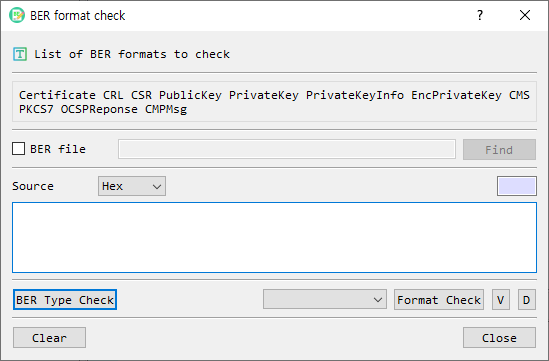

# BER Format Check Dialog Guide

The **BER format check** dialog checks whether BER-encoded data matches a supported PKI format. It can identify a format, validate a selected format, open format-specific details, or decode the data in the main BerEditor window. Open it from **Tool > Check BER**.

*Figure 1. BER format check dialog. Provide a file or encoded source, identify or select a format, then choose the appropriate check or view action.*

## Supported Formats

The dialog can identify or check these formats:

- Certificate
- CRL (certificate revocation list)
- CSR (certificate signing request)
- PublicKey
- PrivateKey
- PrivateKeyInfo
- EncPrivateKey (encrypted private key)
- CMS
- PKCS7
- OCSP response
- CMP message

## Screen Areas

1. **Format list** — Shows the formats supported by the checker.
2. **BER file** — Select this to use a file as the source. The **Find** button opens a BER file picker, and the path is shown beside the checkbox.
3. **Source format** — When **BER file** is unchecked, choose how the source text is represented: **Hex** or **Base64**.
4. **Source length** — Shows the calculated length for the selected source representation.
5. **Source input** — Enter or paste the encoded bytes when using text input.
6. **BER Type Check** — Detects the source's supported PKI format and selects it in the format list.
7. **Format selector** — Choose a specific format to validate or inspect.
8. **Format Check** — Checks whether the source conforms to the selected format and reports success or an error.
9. **V** — Opens the format-specific information view after validating the selected format. Encrypted private keys require a password.
10. **D** — Decodes the source in the main BerEditor window using the selected format title.
11. **Clear** — Clears the file path and source text.
12. **Close** — Closes the dialog.

## Check a Source File or Value

1. Choose the source method:
   - To check a file, select **BER file**, then select **Find** and choose the file.
   - To check encoded text, leave **BER file** unchecked, select **Hex** or **Base64**, and enter the source in the input area.
2. Select **BER Type Check** to detect a supported format, or choose the expected format from the format selector.
3. Select **Format Check** to validate the source against the selected format.
4. Read the success message or the reported format error.

## Open Details or Decode

- After choosing a format, select **V** to open its detail window. The selected format must pass its format check. Available detail views include certificate, CRL, CSR, public/private key, CMS/PKCS7, OCSP response, and CMP message information.
- Select **D** to decode the source in the main BER view. A format must be selected first.
- For an encrypted private key, **V** prompts for the password before showing key details.

## Notes and Troubleshooting

- When using text input, the source must match its selected representation (**Hex** or **Base64**). Invalid or empty input cannot be checked.
- **BER Type Check** identifies only the formats listed above. If the source is unsupported or malformed, the dialog reports that it could not determine a supported format.
- **Format Check** requires a format selection. Choose the expected type or run **BER Type Check** first.
- Use **Clear** before starting a new check to remove the previous file path and source text.
