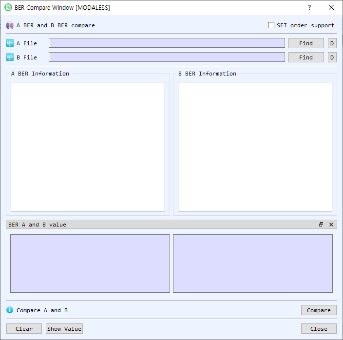

# BER Compare Dialog Guide

The **BER Compare** dialog compares two BER files by their encoded bytes and decoded tree structure. Open it from **Tool > BER Compare**.

*Figure 1. BER Compare dialog. Load one file into each side, then compare the structures and inspect matched values.*

## Screen Areas

1. **SET order support** — Enables matching of SET children without relying on their position in the tree. Use this when the order of SET elements should not affect matching.
2. **A File / B File** — Shows the selected file path for each side.
3. **Find** — Selects a BER file for side A or B and loads its decoded tree.
4. **D** — Decodes the corresponding file in BerEditor's main window.
5. **A BER Information / B BER Information** — Displays the decoded BER tree for each file. Selecting a node highlights it and its corresponding node on the other side when a match is found.
6. **BER A and B value** — Shows the selected nodes' headers and values side by side. If hidden, select **Show Value** to display this pane.
7. **Status / Compare** — Select **Compare** to compare the loaded BER data. The status reports whether A and B are the same or different.
8. **Clear** — Clears both file paths, trees, and value panes.
9. **Show Value** — Shows the BER A and B value pane.
10. **Close** — Closes the dialog.

## Compare Two BER Files

1. Select **Find** on the A File row and choose the first BER file.
2. Select **Find** on the B File row and choose the second BER file.
3. Optionally enable **SET order support** if SET elements may appear in a different order.
4. Select **Compare**.
5. Read the status message. Matching tree nodes are highlighted; select a node to inspect its corresponding node and value on the other side.

You can also drag and drop two local files onto the dialog. The first file fills A and the second fills B. If both sides are already populated, clear the dialog before dropping different files.

## Inspect or Decode a File

- Select a node in either tree to display its encoded header and value in the comparison pane.
- Select **D** beside a file path to decode that file in the main BerEditor window.
- If the value pane is not visible, select **Show Value**.
- Select **Clear** before starting another comparison.

## How Results Are Determined

The dialog first checks whether the complete BER byte sequences are identical. For differing files, it compares nodes by tag, tree depth, definite/indefinite length form, length, and value. A difference in any of these makes the corresponding nodes different. With **SET order support** enabled, SET children are matched by their parent path rather than their original position.

Both files must be loaded before comparison. If either side is empty, BerEditor asks you to select that file.
