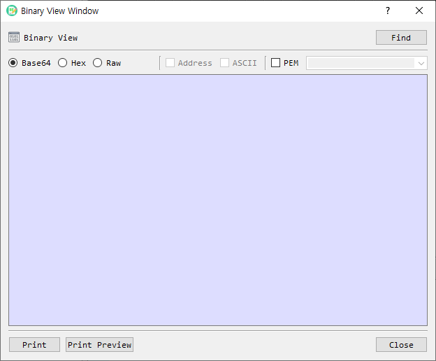

# Binary View Dialog Guide

The **Binary View** dialog displays binary data as Base64, a formatted hexadecimal dump, or a continuous hexadecimal value. Open it from **Tool > Binary View**.

*Figure 1. Binary View dialog. Base64 is selected by default; use Find to load a file and change the output format as needed.*

> The implementation file is named `bin_view_dlg`, while the menu and dialog call this feature **Binary View**.

## Screen Areas

1. **Find** — Opens a file picker and loads a binary file for viewing.
2. **Base64** — Displays the data as Base64 text. This is the default format.
3. **Hex** — Displays a hexadecimal dump in rows of up to 16 bytes.
4. **Raw** — Displays the complete hexadecimal value without row formatting.
5. **Address** — In Hex view, includes each row's offset. Available only in Hex view.
6. **ASCII** — In Hex view, adds printable characters beside each row. Available only in Hex view.
7. **PEM** — Wraps Base64 output with `BEGIN` and `END` lines. Available only in Base64 view.
8. **PEM type** — Selects or enters the label used in the PEM header and footer. The list includes common key, certificate, CSR, CRL, PKCS#7/CMS, and parameter labels.
9. **Output area** — Shows the selected representation. It is read-only.
10. **Print / Print Preview** — Prints the displayed output or previews it before printing.
11. **Close** — Closes the dialog.

## View Binary Data

1. Select **Find** and choose a file, or open Binary View from a selected value in BerEditor.
2. Choose **Base64**, **Hex**, or **Raw**.
3. For Hex view, optionally enable **Address** and **ASCII**.
4. For Base64 view, optionally enable **PEM** and choose or enter a PEM type.
5. Use **Print** or **Print Preview** if you need a paper copy.

Display updates automatically when the format or its options change. The data area is read-only. A local file can also be dragged onto the dialog to load it.

## Format Details

- **Base64** output is line-wrapped. With **PEM** enabled, the selected label is used in the PEM boundary lines.
- **Hex** output is grouped into 16-byte rows. **Address** shows the offset, and **ASCII** shows printable characters for each row.
- **Raw** output is a continuous hexadecimal string; Address and ASCII options are unavailable.
