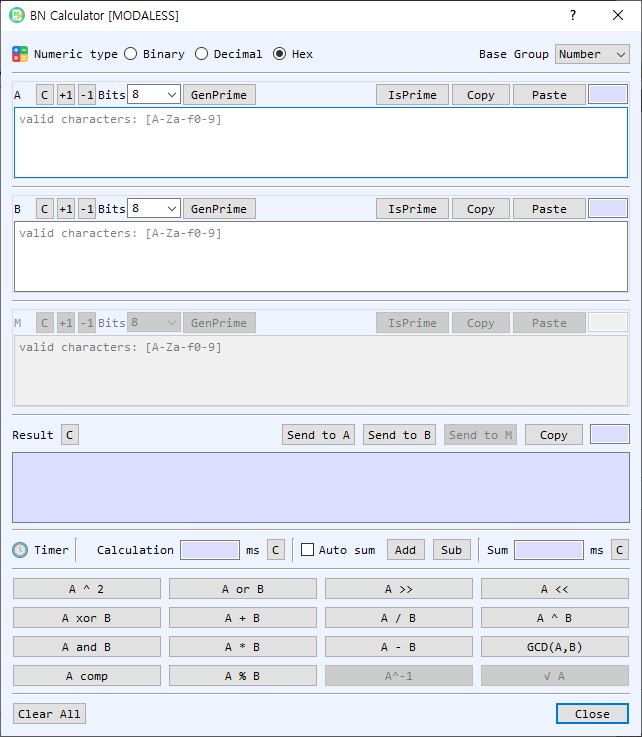

# BN Calculator Dialog Guide

The **BN Calculator** performs arbitrary-precision integer and finite-field calculations. Choose a numeric representation and a base group, enter values in **A**, **B**, and, when needed, **M**, then select an operation.

*Figure 1. BN Calculator with Hex input and the Number base group selected. Available operations depend on the selected base group.*

## Screen Areas

1. **Numeric type** — Choose **Binary**, **Decimal**, or **Hex**. The same representation is used to read inputs and display results. Only digits valid for the selected base are accepted.
2. **Base Group** — Choose **Number**, **Modular**, or **GF2m**. This determines which arithmetic operations are available and how the optional **M** value is used.
3. **A, B, and M fields** — Enter operands. **M** is the modulus used by modular operations; it is disabled when the selected group does not need it. Each section shows the input length and provides its own controls.
4. **C, +1, and -1** — Clear a value or increment/decrement it by one.
5. **Bits, GenPrime, and IsPrime** — Choose a bit length and generate a prime for **A**, **B**, or **M**. **IsPrime** tests the value in that section. Available bit sizes range from 8 to 4096.
6. **Copy / Paste** — Copy a value to the clipboard or paste clipboard contents into the field.
7. **Result** — Displays the calculation result in the selected numeric type. **Send to A**, **Send to B**, and **Send to M** copy the result into the corresponding operand. **Copy** copies the result; **C** clears it.
8. **Timer / Calculation / Sum** — Shows the most recent operation and elapsed time in milliseconds. **Auto sum** adds each operation time to the running total; **Add** and **Sub** manually adjust the total. The adjacent **C** buttons clear the individual time or sum.
9. **Operation buttons** — Run arithmetic, modular, bitwise, shift, or number-theory operations. The available buttons and labels vary with **Base Group**.
10. **Clear All / Close** — Clear all operand and result values, or close the dialog.

## Base Groups and Operations

| Base Group | Operations and behavior |
| --- | --- |
| **Number** | Standard integer addition, subtraction, multiplication, division, exponentiation, square, remainder, GCD, bitwise OR/AND/XOR/complement, shifts, and prime checks. The modular operand is not used. |
| **Modular** | Arithmetic modulo **M**, including modular addition, subtraction, multiplication, division, exponentiation, square, shift, inverse, and square root. Operations that require an inverse or square root may fail if the mathematical conditions are not met. |
| **GF2m** | Arithmetic in a binary extension field using the selected field modulus **M**. Available operations include field addition, subtraction, multiplication, division, exponentiation, square, remainder, inverse, square root, and shifts as enabled in the dialog. |

## Perform a Calculation

1. Select a **Numeric type** and **Base Group**.
2. Enter the required operand values. Use **A** and **B** for binary operations; provide **M** when the selected operation is modular or uses a GF2m modulus.
3. Select the operation button. The result appears in **Result**, and the operation time is shown in **Timer**.
4. To continue calculating, use **Send to A**, **Send to B**, or **Send to M** to reuse the result as an operand.

## Generate or Check a Prime

1. In the desired operand section, choose a bit size from **Bits**.
2. Select **GenPrime** to generate a prime and place it in that field.
3. To test a value already entered, select **IsPrime**. The result is reported in BerEditor's message/log area.

## Timing Operations

- **Timer** displays the latest operation and its elapsed time.
- Enable **Auto sum** to add each measured operation time to **Sum** automatically.
- Use **Add** or **Sub** to adjust the sum by the latest operation time. Clear the latest timer or accumulated sum with its adjacent **C** button.

## Notes

- Hexadecimal values with an odd number of digits are padded with a leading zero internally for input conversion.
- Division by zero, invalid modular inverses, and other undefined operations produce a calculation error.
- In **Modular** and **GF2m** groups, select a valid modulus **M** appropriate to the operation. A generated prime can help create a modulus for prime-field calculations.
- The **GF2m** group performs arithmetic over a binary extension field; its operations do not use ordinary integer arithmetic semantics.
