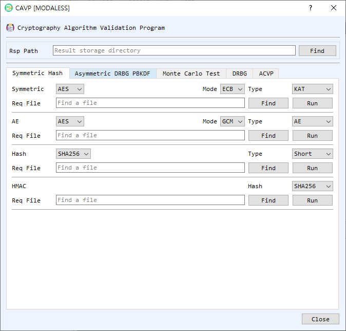

# CAVP Dialog Guide

The **CAVP** dialog processes cryptographic algorithm test-vector request files and writes response files. It includes symmetric and asymmetric algorithms, hash and MAC tests, Monte Carlo tests, DRBG, PBKDF, and ACVP JSON utilities.

*Figure 1. CAVP dialog on the Symmetric Hash tab. Select a request file, configure the matching algorithm and test type, and run the test to create a response file.*

## Shared Control: Rsp Path

**Rsp Path** is the directory where response files are written. Use **Find** to select a result folder. The dialog remembers this folder. For standard request-file runs, the output is named after the request file with an `.rsp` extension.

## Symmetric Hash Tab

This tab contains separate request-file processors:

- **Symmetric** — Select a symmetric algorithm, mode (**ECB**, **CBC**, **CTR**, **CFB**, or **OFB**), and test type (**KAT**, **MCT**, or **MMT**). Use **Find** to select the request file and **Run** to process it.
- **AE** — Process authenticated-encryption vectors. Select **AES** or **ARIA**, **GCM** or **CCM**, and the test type (**AE** or **AD**), then choose the request file and run it.
- **Hash** — Select a hash algorithm and test type (**Short**, **Long**, or **Monte**), then process the request file.
- **HMAC** — Select the hash algorithm used by HMAC, then choose the request file and run it.

## Asymmetric DRBG PBKDF Tab

- **ECC** — Select **ECDSA** or **ECDH**, a test type, curve parameter, and hash where applicable. Choose the request file and select **Run**.
- **RSA** — Select **RSAES** or **RSA PSS**, the test type and hash, and the request file. For deterministic RSA signature tests, use **Find DET PrivateKey** to supply the private key. **E** is the RSA public exponent input.
- **DRBG** — Process a DRBG request file using **CIPHER**, **Hash**, or **HMAC** method. Select the algorithm and configure **Use PR** and **Use DF** as required by the vector set.
- **PBKDF** — Select the hash algorithm and process its request file.

Each area has a **Find** button for the request file and a **Run** button to generate the response.

## Monte Carlo Test Tab

- **Symmetric MCT** — Select algorithm, mode, direction (**Encrypt** or **Decrypt**), and count. Enter or inspect the starting **Key**, **IV**, **PT**, and **CT**, and the corresponding last values. Select **Run** to generate the Monte Carlo results; **Clear** resets the fields.
- **Hash MCT** — Select the hash algorithm and MCT version (**standard** or **alternate**). Enter the count, **Seed**, and any required **First MD** / **Last MD** values, then select **Run**. **Clear** resets the fields.

## DRBG Tab

This tab runs a DRBG test from explicit inputs rather than a request file. Select the **Method** (**CIPHER**, **Hash**, or **HMAC**) and **Algorithm**, set **Rand Len** in bits, and choose **Use DF** and **Use PR** to match the desired test. Enter the available values as hexadecimal: **EntropyInput**, **Nonce**, **PersonalString**, reseed entropy/additional input, and generation **AdditionalInput** values. Select **Run** to display **ReturnedBits**; **Clear** resets the inputs and result.

## ACVP Tab

- **ACVP Request Response** — Select a JSON request file with **Find**, then choose **Run** to generate the response JSON. **SetTgId** and **SetTcId** limit processing to the specified test group or test case ID. **SkipLDT** skips long-duration tests when supported. **Clear** clears the request path.
- **ACVP Hash LDT** — Enter the content (hexadecimal), hash algorithm, and **Full Length Bits** to hash a repeated content sequence. **Run** processes it in the foreground. **Thread Run** starts threaded processing and **Thread Stop** stops that work. Progress and current processed bit count appear in the status fields; **MD** displays the digest. **Clear** resets the LDT fields and progress.

## Run a Request-File Test

1. Set **Rsp Path** to the directory where results should be saved.
2. Open the tab for the test family and select the algorithm, mode, test type, hash, curve, or other options required by the request vectors.
3. Use **Find** to select the matching request file.
4. Select **Run**. If the request filename does not appear to match the selected algorithm and test settings, the dialog asks you to confirm before continuing.
5. Review the completion message and the generated `.rsp` file in the result directory.

## Notes

- Match the selected settings to the request file's algorithm and test type. A mismatch can produce invalid or incomplete response data.
- CAVP request-file processing and ACVP JSON processing use different tabs and file formats; choose the workflow matching your input.
- This tool computes responses to test vectors. Running vectors in BerEditor does not itself constitute formal NIST algorithm validation or certification.
- Protect private-key files used for deterministic RSA tests and keep generated response files with their corresponding request files.
