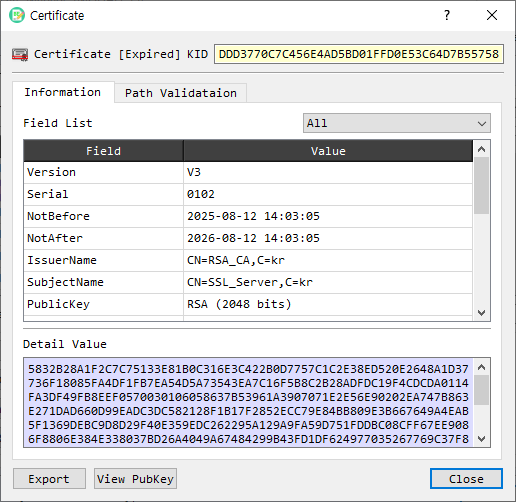

# Certificate Information

The **Certificate Information** dialog displays the fields and extensions in an X.509 certificate, provides certificate path and status checks, and offers certificate export and management actions.

## Certificate overview

The header identifies the certificate and displays its **KID** (Key Identifier) when available. The **Information** tab presents parsed fields in a table. Select a row to see its value in **Detail Value**. The **Field List** filter can show all fields, version 1 fields, extensions, critical extensions, or attributes. Use **View PubKey** to inspect the certificate's public key.

## Certificate path

The **Path Validation** tab shows the certificate path tree and related path information. Select a certificate in the tree to inspect it or open its context actions. The available controls include:

| Control | Description |
|---|---|
| Make Tree | Builds a certificate path tree. |
| Cert PVD | Runs certificate path validation. |
| Get CA | Retrieves the CA certificate associated with this certificate and opens its information. |
| Save to CA | Saves the CA certificate to the CA store. |
| Save to Man | Saves the certificate to CertMan. |
| Save To RCA | Saves the certificate as a trusted root CA. |
| Verify Cert | Verifies the certificate signature. |
| CRL Check | Checks whether the certificate is revoked using a CRL. |
| OCSP Check | Checks certificate status with an OCSP server. |
| OCSP Client | Opens the OCSP client. |
| GetURL CA / GetURL CRL | Retrieves the CA or CRL distribution URL from the certificate. |
| Get CRL | Retrieves the CRL and opens its information. |
| Decode Cert | Decodes the certificate in the main BerEditor view. |

Some path and CertMan actions are available only in the licensed version.

## Export and other actions

- **Export** saves the certificate in PEM format.
- **View PubKey** opens the public key information dialog.
- **Close** closes the certificate information dialog.

## Review a certificate

1. Open a certificate in BerEditor's certificate information dialog.
2. Review its parsed fields in **Information**. Select fields to inspect their detailed values; adjust **Field List** to narrow the table.
3. To inspect trust or revocation, open **Path Validation** and use **Make Tree**, **Cert PVD**, **Verify Cert**, **CRL Check**, or **OCSP Check** as appropriate.
4. Use **Export** to save a PEM copy, or **Save to Man** / CA controls to add it to the relevant store.
