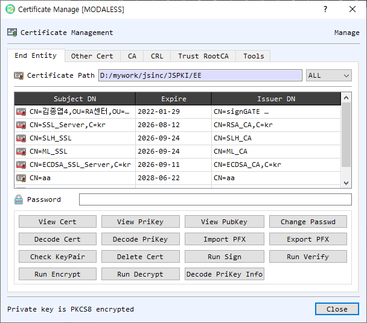

# CertMan Dialog Guide

The **Certificate Management** dialog organizes certificates, private keys, certificate authorities, CRLs, and trusted root CAs. It also provides common certificate and key operations. The available tabs and actions depend on the selected management mode.

*Figure 1. CertMan on the End Entity tab. Select a certificate row to view, export, verify, or use its associated key.*

## Tabs

- **End Entity** — Manage end-entity certificates and their associated private keys. The table shows subject DN, expiration, and issuer DN. Use the password field when the stored private key is encrypted.
- **Other Cert** — Manage additional certificates that are not in the End Entity list; inspect, decode, verify, encrypt to, export, add, or remove them.
- **CA** — Manage CA certificates used to build certificate paths. Add, view, decode, export, or remove CA certificates.
- **CRL** — Manage certificate revocation lists. Add, view, decode, export, or remove CRLs.
- **Trust RootCA** — Manage trusted root certificates, view or export their public keys, load system trust certificates, and remove trust entries.
- **Tools** — Work with a private key, certificate, or PFX file. Check key-pair correspondence, inspect key/certificate data, create or extract a PFX, encrypt/decrypt a PFX, and save a PFX entry into End Entity storage.

## End Entity Screen Areas

1. **Certificate Path** — Shows the configured End Entity certificate storage folder. The filter can show all entries or narrow the list by key algorithm.
2. **Certificate table** — Lists stored end-entity certificates by subject DN, expiration date, and issuer DN. Select a row before using the action buttons.
3. **Password** — Enter the password for an encrypted private key associated with the selected certificate when a private-key action requires it.
4. **View Cert / View PriKey / View PubKey** — Inspect the selected certificate or its associated private/public key.
5. **Decode Cert / Decode PriKey / Decode PriKey Info** — Decode certificate, private-key, or private-key information data in BerEditor.
6. **Check KeyPair** — Check whether the selected certificate's public key matches its associated private key.
7. **Run Sign / Run Verify / Run Encrypt / Run Decrypt** — Launch the corresponding cryptographic operation using the selected certificate/key material.
8. **Change Passwd** — Change the password protecting the selected private key.
9. **Import PFX / Export PFX** — Import or export a PFX package containing certificate/key material.
10. **Delete Cert** — Remove the selected end-entity entry.
11. **OK / Close** — **OK** confirms a selection when CertMan is opened in a selection mode. **Close** dismisses the dialog.

## Manage Certificates and Revocation Data

1. Choose the relevant tab: **End Entity**, **Other Cert**, **CA**, **CRL**, or **Trust RootCA**.
2. Select a row to enable the actions for that item. Use **Add** to import an item into the current store, or **Remove/Delete** to remove it.
3. Use **View**, **Decode**, or **Export** to inspect or save an item. Right-click a table row for additional item actions.
4. In End Entity storage, enter the private-key password before using actions that need the private key. Use **Check KeyPair** to verify that the certificate and private key match.

## PFX and Tools

- In the **Tools** tab, choose a private-key file, certificate, or PFX file with **Find**. Enable **Encrypted PrivateKey** and enter the password when the private key is protected.
- **Check KeyPair** checks whether the selected private key matches the certificate's public key.
- **Encrypt PFX** creates a PFX package from a private key and certificate; **Decrypt PFX** extracts key/certificate files from a PFX. Select an encryption mode and enter the PFX password as required.
- **Save PFX to EE** stores the PFX certificate and private key in the End Entity list.
- **Load System Trust** imports available system trust certificates into the Trust RootCA store.

## Notes

- The certificate path shown on each tab points to that store's configured directory.
- Selecting a certificate for an operation may open CertMan in a restricted selection mode. In that mode, double-click a suitable row or select it and confirm with **OK**.
- Private-key passwords and PFX passwords protect sensitive key material. Keep them private and verify the selected certificate/key pair before signing or decrypting.
