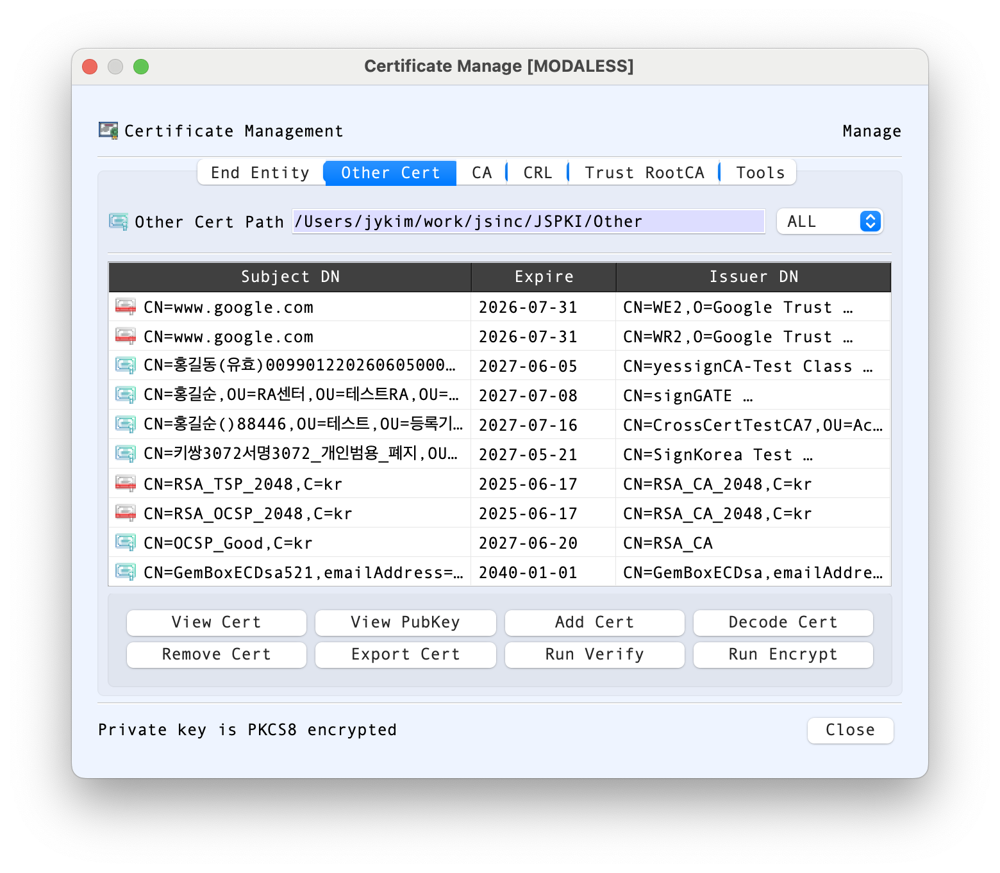
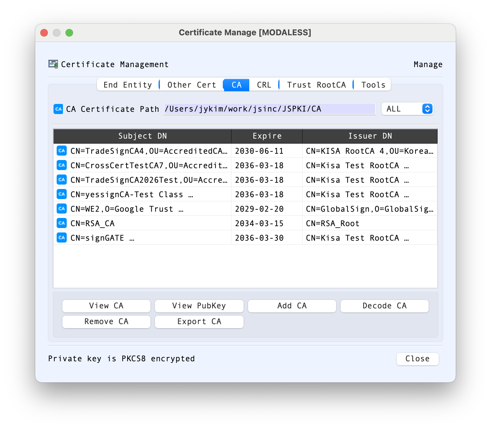
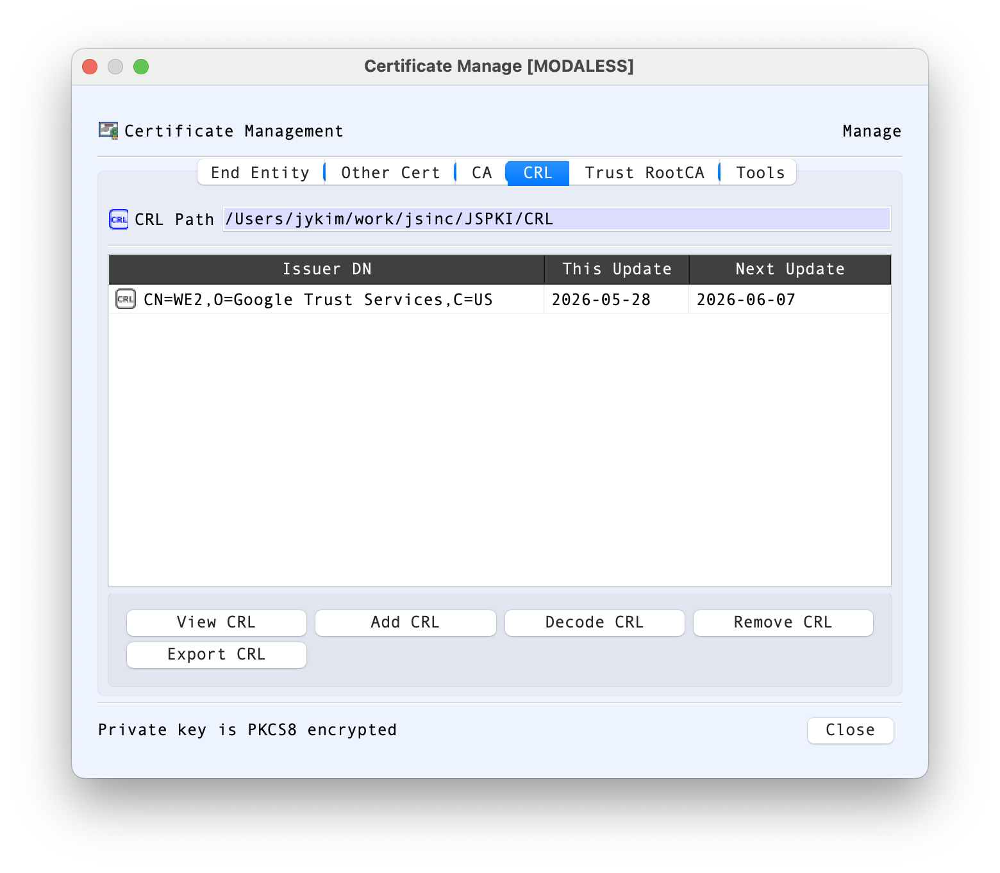
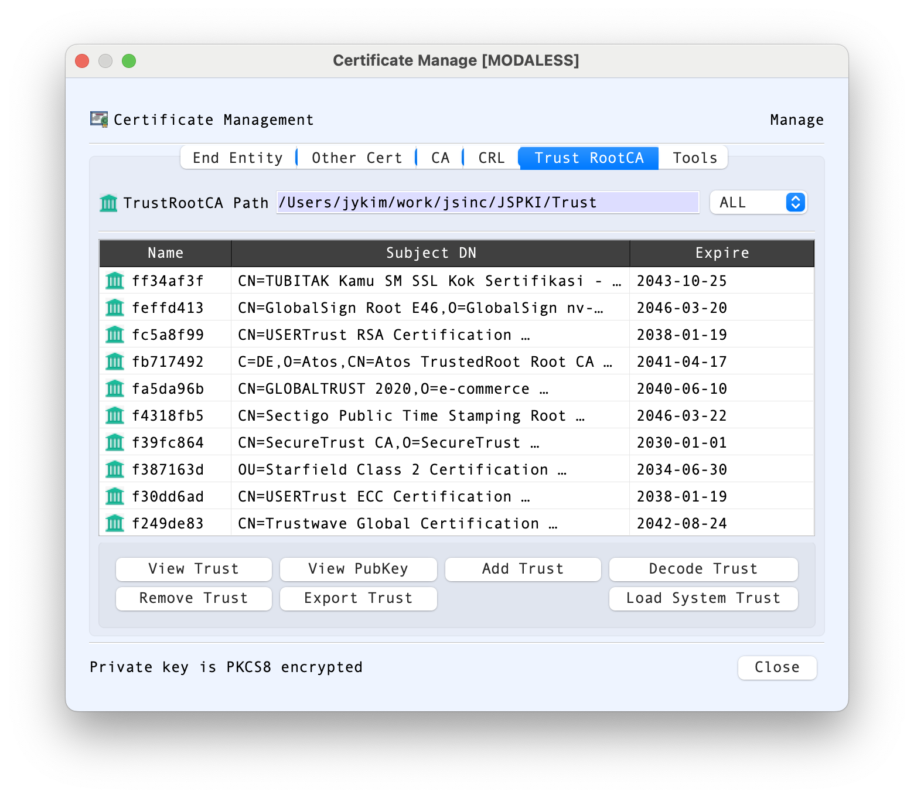
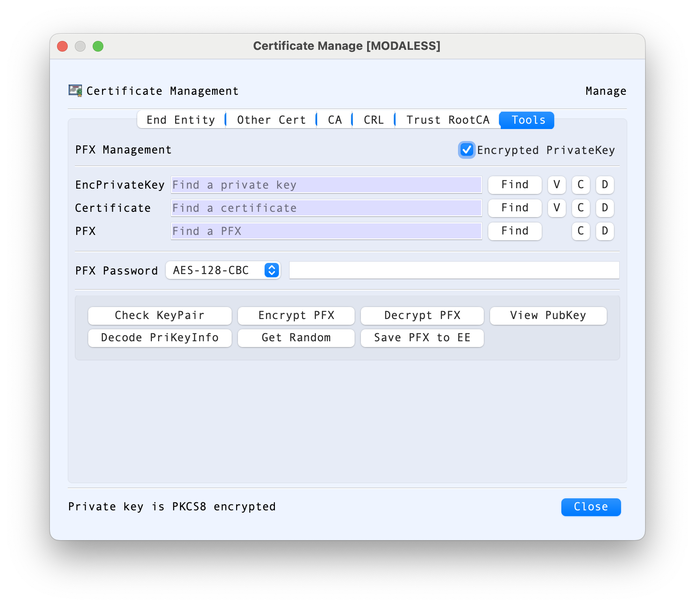

# CertMan Dialog Guide

The **Certificate Management** dialog organizes certificates, private keys, certificate authorities, CRLs, and trusted root CAs. It also provides common certificate and key operations. The available tabs and actions depend on the selected management mode.

*Figure 1. CertMan on the End Entity tab. Select a certificate row to view, export, verify, or use its associated key.*

## Tabs

- **End Entity** — Manage end-entity certificates and their associated private keys. The table shows subject DN, expiration, and issuer DN. Use the password field when the stored private key is encrypted.
- **Other Cert** — Manage additional certificates that are not in the End Entity list; inspect, decode, verify, encrypt to, export, add, or remove them.
- **CA** — Manage CA certificates used to build certificate paths. Add, view, decode, export, or remove CA certificates.
- **CRL** — Manage certificate revocation lists. Add, view, decode, export, or remove CRLs.
- **Trust RootCA** — Manage trusted root certificates, view or export their public keys, load system trust certificates, and remove trust entries.
- **Tools** — Work with a private key, certificate, or PFX file. Check key-pair correspondence, inspect key/certificate data, create or extract a PFX, encrypt/decrypt a PFX, and save a PFX entry into End Entity storage.

The screenshots below show the additional tabs and their controls. The certificate paths and certificate names shown are examples from one installation; the contents depend on the local stores.

### Other Cert

*Figure 2. The Other Cert list shows subject DN, expiration date, and issuer DN.*

This tab is for certificates kept outside the End Entity store, such as certificates that you need to inspect or use without managing an associated private key here. The key-type filter can narrow the list by algorithm. Select a row to use **View Cert**, **Decode Cert**, **View PubKey**, **Export Cert**, **Run Verify**, or **Run Encrypt**. **Add Cert** imports a certificate into this store, and **Remove Cert** removes the selected entry. A row's context menu provides additional actions.

### CA

*Figure 3. CA certificates are listed by subject DN, expiration date, and issuer DN.*

Use this tab to maintain intermediate or other CA certificates used by certificate-path workflows. The path field identifies the configured CA store, and the key-type filter narrows the displayed list. **Add CA** imports a CA certificate; **Remove CA** removes the selected one. **View CA** opens its certificate details, **Decode CA** sends its encoded data to the decoder, **View PubKey** displays the public key, and **Export CA** saves the certificate to a file. These actions manage the CA store; they do not themselves assert that a chain is trusted or valid.

### CRL

*Figure 4. The CRL list displays each issuer and its This Update and Next Update dates.*

The CRL tab manages Certificate Revocation Lists. The list's update fields help you identify the CRL's stated validity period and freshness. Use **Add CRL** to import a list, **View CRL** to inspect its information, **Decode CRL** to examine its encoded structure, and **Export CRL** or **Remove CRL** to save or remove the selected item. Check the issuer and update dates when choosing a CRL; the dates alone do not establish that it is current or applicable to a particular certificate.

### Trust RootCA

*Figure 5. The trust list shows a local name, subject DN, and expiration date for each root certificate.*

This tab manages root certificates in the configured trust store. Select an entry to **View Trust**, **View PubKey**, **Decode Trust**, or **Export Trust**. **Add Trust** adds a certificate to the store, and **Remove Trust** removes the selected entry. **Load System Trust** imports certificates available from the operating system's trust store. Adding a certificate here changes the local trust configuration; only add roots you intend to trust.

### Tools: private keys and PFX files

*Figure 6. The Tools tab accepts a private-key file, a certificate, or a PFX file.*

The Tools tab provides a file-based workflow that is separate from selecting an existing End Entity entry:

- Use **Find** beside **EncPrivateKey**, **Certificate**, or **PFX** to choose an input file. The small **V**, **C**, and **D** controls beside key and certificate inputs provide view, clear, and decode actions; PFX provides clear and decode controls.
- Enable **Encrypted PrivateKey** and enter the private-key password when the selected key file is encrypted. The status line at the bottom reports the key encryption state when known.
- Choose a PFX encryption mode and provide a PFX password for PFX creation or extraction as required.
- **Check KeyPair** checks whether the selected private key matches the public key in the selected certificate. **View PubKey** and **Decode PriKeyInfo** help inspect the key material. **Get Random** generates random data for the workflow.
- **Encrypt PFX** packages the selected key and certificate into a PFX file. **Decrypt PFX** extracts material from a selected PFX. **Save PFX to EE** imports the PFX contents into End Entity storage.

Use **Clear** to remove an input from the corresponding field before choosing another file. Treat private keys and PFX files as sensitive material, and protect exported files and passwords accordingly.

## End Entity Screen Areas

1. **Certificate Path** — Shows the configured End Entity certificate storage folder. The filter can show all entries or narrow the list by key algorithm.
2. **Certificate table** — Lists stored end-entity certificates by subject DN, expiration date, and issuer DN. Select a row before using the action buttons.
3. **Password** — Enter the password for an encrypted private key associated with the selected certificate when a private-key action requires it.
4. **View Cert / View PriKey / View PubKey** — Inspect the selected certificate or its associated private/public key.
5. **Decode Cert / Decode PriKey / Decode PriKey Info** — Decode certificate, private-key, or private-key information data in BerEditor.
6. **Check KeyPair** — Check whether the selected certificate's public key matches its associated private key.
7. **Run Sign / Run Verify / Run Encrypt / Run Decrypt** — Launch the corresponding cryptographic operation using the selected certificate/key material.
8. **Change Passwd** — Change the password protecting the selected private key.
9. **Import PFX / Export PFX** — Import or export a PFX package containing certificate/key material.
10. **Delete Cert** — Remove the selected end-entity entry.
11. **OK / Close** — **OK** confirms a selection when CertMan is opened in a selection mode. **Close** dismisses the dialog.

The key-type filter can be used to narrow entries to algorithms such as RSA, ECDSA, DSA, SM2, or EdDSA; post-quantum key types may also appear when enabled by the caller. The **ALL** choice shows entries without an algorithm filter. The certificate table can be sorted by its displayed columns, which is useful when locating a subject or checking expiration and issuer information.

## Manage Certificates and Revocation Data

1. Choose the relevant tab: **End Entity**, **Other Cert**, **CA**, **CRL**, or **Trust RootCA**.
2. Select a row to enable the actions for that item. Use **Add** to import an item into the current store, or **Remove/Delete** to remove it.
3. Use **View**, **Decode**, or **Export** to inspect or save an item. Right-click a table row for additional item actions.
4. In End Entity storage, enter the private-key password before using actions that need the private key. Use **Check KeyPair** to verify that the certificate and private key match.

## PFX and Tools

- In the **Tools** tab, choose a private-key file, certificate, or PFX file with **Find**. Enable **Encrypted PrivateKey** and enter the password when the private key is protected.
- **Check KeyPair** checks whether the selected private key matches the certificate's public key.
- **Encrypt PFX** creates a PFX package from a private key and certificate; **Decrypt PFX** extracts key/certificate files from a PFX. Select an encryption mode and enter the PFX password as required.
- **Save PFX to EE** stores the PFX certificate and private key in the End Entity list.
- **Load System Trust** imports available system trust certificates into the Trust RootCA store.

## Notes

- The certificate path shown on each tab points to that store's configured directory.
- Selecting a certificate for an operation may open CertMan in a restricted selection mode. In that mode, double-click a suitable row or select it and confirm with **OK**.
- Private-key passwords and PFX passwords protect sensitive key material. Keep them private and verify the selected certificate/key pair before signing or decrypting.
