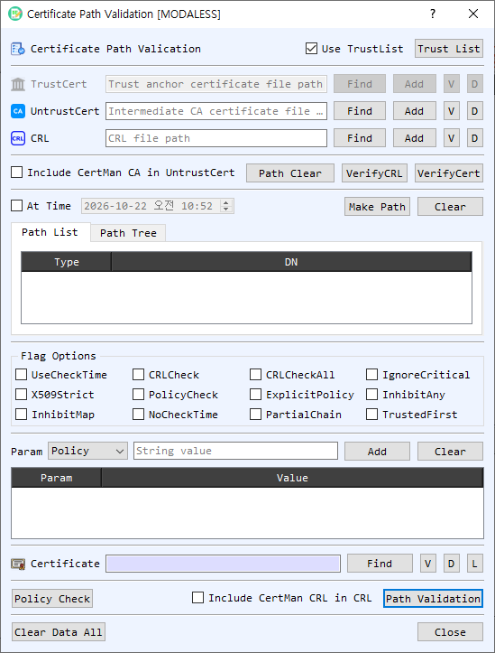

# Certificate Path Validation Dialog Guide

The **Certificate Path Validation** dialog helps build and inspect a certificate chain, validate a target certificate, check certificate policies, and verify CRLs. It can use certificates and CRLs selected from files or stored in BerEditor's CertMan lists.

*Figure 1. Certificate Path Validation dialog. Supply trust and revocation data, select a target certificate, then build or validate its certificate path.*

## Screen Areas

1. **Use TrustList / Trust List** — Enable **Use TrustList** to validate against BerEditor's configured trust list. **Trust List** opens CertMan's root CA list. When disabled, provide a specific TrustCert file for the operation.
2. **TrustCert, UntrustCert, and CRL** — Select files with **Find** or choose entries from CertMan with **Add**. **V** opens certificate or CRL information; **D** decodes the selected file in BerEditor. TrustCert supplies trust anchors, UntrustCert supplies certificates treated as untrusted, and CRL supplies revocation information.
3. **Include CertMan CA in UntrustCert** — Includes CertMan CA certificates in the untrusted certificate input for path validation.
4. **Path Clear / VerifyCRL / VerifyCert** — **Path Clear** clears the displayed path. **VerifyCRL** checks a CRL against the selected trust or untrusted certificate. **VerifyCert** checks the selected certificate using the trust, untrusted, and optional CRL inputs.
5. **At Time / Make Path / Clear** — Enable **At Time** to use the selected date and time for path checks. **Make Path** builds a chain for the target certificate; **Clear** clears the path list and tree.
6. **Path List / Path Tree** — View the built chain as a table or hierarchical tree. Double-click an entry to view its details. Right-click for available item actions.
7. **Flag Options** — Configure certificate-path verification behavior, including CRL checking, policy checks, critical-extension handling, strict X.509 processing, time checks, partial chains, and trust-anchor selection. Use flags only when their validation behavior is intended.
8. **Param** — Add verification parameters such as **Policy**, **Purpose**, **Name**, **Depth**, **AuthLevel**, **HostName**, **Email**, and **IP**, with a corresponding value. **Add** appends the selected parameter; **Clear** removes the parameter list. Right-click table entries for item actions.
9. **Certificate target** — Select the target certificate with **Find** or **L** (select from CertMan). The subject DN appears in the adjacent field. **V** views certificate details and **D** decodes it in BerEditor.
10. **Policy Check / Path Validation** — Run a policy check or validate the target's certificate path using the selected inputs, flags, parameters, and time options. **Include CertMan CRL in CRL** adds CertMan CRLs to path validation.
11. **Clear Data All / Close** — Clear the dialog's inputs and results or close the dialog.

## Build a Certificate Path

1. Select a target certificate using **Find** or **L**. The subject DN confirms the selected target.
2. Enable **Use TrustList** to use the configured trust list, or select a **TrustCert** file for a specific trust anchor.
3. Add any relevant **UntrustCert** certificates and **CRL** data. To use CertMan's stored CA or CRL data, enable the applicable inclusion option.
4. If required, enable **At Time** and set the validation date and time. Configure any needed verification flags and parameters.
5. Select **Make Path**. Review the resulting chain in **Path List** or **Path Tree**. When online CA/CRL retrieval is enabled in BerEditor settings, path construction may retrieve issuer or status data online.

## Validate a Certificate or Check a CRL

- To check the target certificate, select the certificate and configure the trust and revocation inputs, then select **VerifyCert**. Review the result reported in the log.
- To verify a CRL, provide a CRL and its issuing certificate as TrustCert or UntrustCert, then select **VerifyCRL**.
- To perform full path validation, select **Path Validation** after setting the target, trust data, optional CRLs, flags, parameters, and time. Use **Policy Check** when you want to check the configured certificate policy parameters.

## Verification Flags

The dialog exposes these options (some may be below the visible area depending on window size):

| Option | Use |
| --- | --- |
| `UseCheckTime` / `NoCheckTime` / `At Time` | Control certificate time evaluation and the selected validation time. |
| `CRLCheck` / `CRLCheckAll` | Enable CRL checking for certificates in the chain or throughout the chain. |
| `IgnoreCritical` | Ignore unrecognized critical extensions. |
| `X509Strict` | Apply stricter X.509 checks. |
| `PolicyCheck` / `ExplicitPolicy` | Enable policy processing and explicit policy requirements. |
| `InhibitAny` / `InhibitMap` | Restrict anyPolicy or policy mapping behavior. |
| `PartialChain` | Allow a chain to terminate at an intermediate certificate. |
| `TrustedFirst` | Prefer trusted certificates when building the chain. |

## Notes

- A successful path depends on a valid target certificate, suitable trust anchors, complete issuer certificates, and any required revocation data.
- **VerifyCert**, **VerifyCRL**, **Policy Check**, and **Path Validation** are separate operations and report their results in BerEditor's message/log area.
- Online retrieval during **Make Path** follows the online CA/CRL setting configured in BerEditor.
