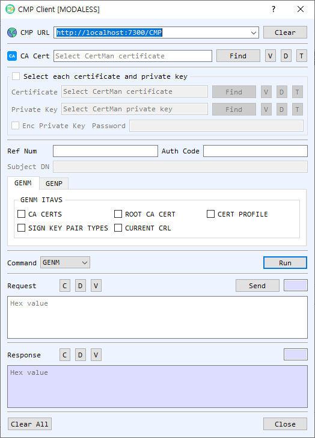

# CMP Client Dialog Guide

The **CMP Client** creates and sends Certificate Management Protocol requests for certificate enrollment and management. It supports request types including initial request, certification request, key update, revocation, and general messages.

*Figure 1. CMP Client dialog with GENM selected. The enabled credential and request fields depend on the selected command.*

## Screen Areas

1. **CMP URL** — Enter or select the CMP server endpoint. **Clear** clears the URL history/input.
2. **CA Cert** — Select the CA certificate used by CMP. **Find**, **V**, **D**, and **T** browse, view, decode, or identify the certificate.
3. **Select each certificate and private key** — Enable this group to select a client certificate and private key from files; otherwise use CertMan. Enable **Enc Private Key** and enter its password if the key file is encrypted.
4. **Ref Num / Auth Code** — Enter the reference number and authorization code supplied by the CA for enrollment commands that use the out-of-band credentials.
5. **Subject DN** — Enter the requested subject distinguished name for **IR** or **CR** requests.
6. **GENM / GENP tabs** — **GENM** exposes General Message Information Type and Value (ITAV) options such as **CA CERTS**, **ROOT CA CERT**, **CERT PROFILE**, **CURRENT CRL**, and **SIGN KEY PAIR TYPES**. **GENP** provides general message parameters where available.
7. **Command / Run** — Select the CMP operation and choose **Run** to create the request. Supported commands are **GENM**, **IR**, **CR**, **P10CR**, **SignGENM**, **KUR**, and **RR**.
8. **Request** — Displays the encoded CMP request. **Send** transmits the request to the CMP URL. **C**, **D**, and **V** clear, decode, or view the request.
9. **Response** — Displays the received CMP response. **C**, **D**, and **V** clear, decode, or view it.
10. **Clear All / Close** — Clear the dialog or close the client.

## Create and Send a CMP Request

1. Enter the CMP server URL and select the CA certificate.
2. Choose a command. For **IR** or **CR**, enter the requested **Subject DN**. For **GENM** or **SignGENM**, select the required ITAV options. Enrollment commands may require **Ref Num** and **Auth Code**.
3. For commands requiring an existing identity, enable **Select each certificate and private key** and choose the matching client certificate/key, or select them from CertMan.
4. Select **Run** to create the request. Review it with **V** or **D** if needed.
5. Select **Send** and review the response. Issued certificate/private-key material may be offered for saving to CertMan.

## Command Reference

| Command | Purpose |
| --- | --- |
| `GENM` | Request general information from the CA using selected ITAV values. |
| `IR` | Initial certificate request. |
| `CR` | Request certificate issuance for a subject. |
| `P10CR` | Submit a PKCS #10 certificate request. |
| `SignGENM` | Send a signed general message using client credentials. |
| `KUR` | Request a key update using an existing certificate/key pair. |
| `RR` | Request certificate revocation using the existing certificate/key pair. |

## Notes

- The server URL, CA certificate, and command-specific credentials must match the CMP CA configuration.
- Reference numbers and authorization codes are enrollment secrets; handle them as credentials.
- A generated request is not sent until **Send** is selected. Review the response and any certificate/key save prompts.
