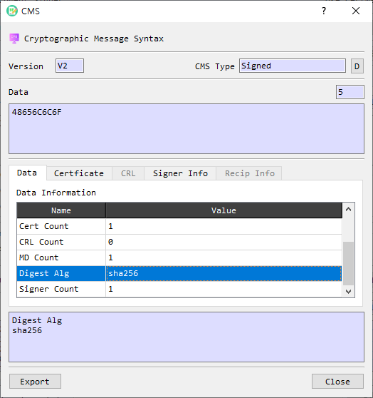

# CMS Information Dialog Guide

The **CMS Information** dialog displays the structure and contents of a Cryptographic Message Syntax (CMS) or PKCS#7 object. Depending on the message type, it can show data, certificates, CRLs, signer details, and recipient details.

*Figure 1. CMS Information dialog displaying a SignedData object. Tabs and fields vary with the CMS content and the information embedded in it.*

## Header and content

| Area | Description |
|---|---|
| Version | Displays the CMS or PKCS#7 structure version. |
| CMS Type | Identifies the content type, such as Signed or Enveloped. Select **D** to decode the CMS object in BerEditor's main view. |
| Data / length | Displays the content or encrypted content as hexadecimal data and shows its length. The value depends on the CMS type. |
| Export | Opens the export dialog for the CMS/PKCS#7 object. |
| Close | Closes the dialog. |

## Information tabs

The **Data** tab shows the parsed fields available for the CMS type. Examples include content type, digest or encryption algorithms, signer or recipient counts, embedded certificate and CRL counts, and a verification result when the parser provides one. Select a row to display its name and value in the detail area below the tabs.

Other tabs become available when the corresponding data is present:

| Tab | Description |
|---|---|
| Certificate | Lists embedded certificates by subject DN, expiration, and issuer DN. Double-click a certificate row to open its Certificate Information dialog. |
| CRL | Lists embedded certificate revocation lists by issuer DN and update dates. Double-click a CRL row to open its CRL Information dialog. |
| Signer Info | Displays parsed signer information, such as version, issuer, serial number, signing time, digest and signature algorithms, signature, and available signed or unsigned attributes. Select a row to view its value in the detail area. |
| Recip Info | Displays recipient information available for enveloped content. Select a row to view its value in the detail area. |

The exact fields depend on the CMS content type and what the object contains. For example, an enveloped message may provide recipient details, while a signed message may provide signer details and embedded certificates.

## Timestamp controls

**View TSP** and **View TST** are shown when the CMS object contains timestamp information. **View TSP** opens the timestamp token as another CMS object. **View TST** opens its decoded Time-Stamp Token information.

## Review a CMS object

1. Open a CMS or PKCS#7 object to display its information dialog.
2. Check **CMS Type**, **Version**, and the displayed content or encrypted content.
3. Review the **Data** tab, then select any enabled Certificate, CRL, Signer Info, or Recip Info tab to inspect available details.
4. Double-click an embedded certificate or CRL to open its dedicated information dialog.
5. Use **D** to decode the complete CMS object in the main viewer, or **Export** to save the object through the export dialog.

The displayed parsing or signature verification result is information about the CMS object's processing. It does not, by itself, establish certificate trust, revocation status, or the safety of the content.
