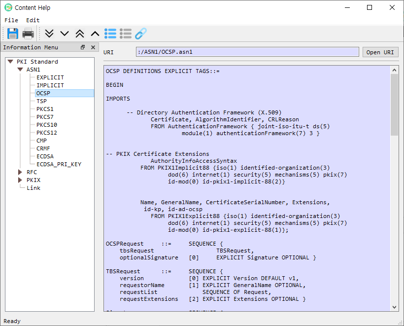

# Content Help

The **Content Help** window provides ASN.1 and PKI reference material, RFC documents, and managed web links. Select an item in the information tree to display its content.

## Main areas

| Area | Description |
|---|---|
| Information Menu | Tree of ASN.1 references, RFCs, PKIX documents, and managed links. The menu can be shown or hidden from the Edit toolbar/menu. |
| Content pane | Displays the selected reference, locally available document, or retrieved web content. |
| URI | Shows the address associated with the selected online item or the resource path for a built-in reference. |
| Open URI | Opens an HTTP or HTTPS address in the system browser. |

The tree is populated for licensed installations. RFC and PKIX pages are retrieved from the configured reference sites and cached locally after the first load. Built-in ASN.1 references are loaded from application resources. Managed links are configured through Link Manage.

## Browse references

1. Expand a category in **Information Menu**.
2. Select an item to show its content in the content pane.
3. For an online reference, review the displayed URI and select **Open URI** to open it in the system browser.
4. Use **Find** to search within the displayed content.

## Toolbar and menu actions

- **Save** saves the selected reference to a file.
- **Print** and **Print Preview** print the displayed content.
- **Expand All / Expand Node** and **Collapse All / Collapse Node** control the tree.
- **Show Menu / Hide Menu** toggles the information tree.
- **Link Manage** opens the link manager for maintaining custom links.
- **Quit** closes the Content Help window.

Keyboard shortcuts are shown in the corresponding application menu. The toolbar includes shortcuts for Save (`Ctrl+1`), Print (`Ctrl+2`), Expand All (`Ctrl+4`), Expand Node (`Ctrl+5`), Collapse All (`Ctrl+6`), Collapse Node (`Ctrl+7`), Show Menu (`Ctrl+8`), Hide Menu (`Ctrl+9`), and Link Manage (`Ctrl+A`).
