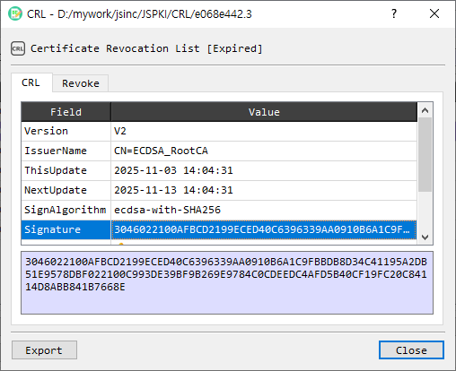

# CRL Information

The **CRL Information** dialog displays the metadata and revoked-certificate entries in an X.509 Certificate Revocation List (CRL). It also provides signature verification, decoding, export, and CertMan actions.

## CRL tab

The **CRL** tab lists parsed CRL fields in a **Field / Value** table. Select a field to view its value in the detail area below the table.

## Revoke tab

The **Revoke** tab lists revoked certificates by **Serial** and **RevokedDate**. Select an entry to display its serial number, revocation date, and available revocation details in the detail table.

## Actions

| Control | Description |
|---|---|
| Verify CRL | Verifies the CRL signature. |
| Decode CRL | Decodes the CRL in the main BerEditor view. |
| Save to CertMan | Saves the CRL to CertMan. This control is available in licensed mode. |
| Export | Exports the CRL as a PEM file. |
| Close | Closes the dialog. |

## Inspect or export a CRL

1. Open a CRL in the **CRL Information** dialog.
2. Review the metadata on the **CRL** tab, or select **Revoke** to inspect revoked entries.
3. Select an entry to view its details.
4. Select **Verify CRL** to check its signature, or **Decode CRL** to inspect the encoded structure in the main window.
5. Select **Export** to save a PEM copy. In licensed mode, use **Save to CertMan** to store the CRL there.
