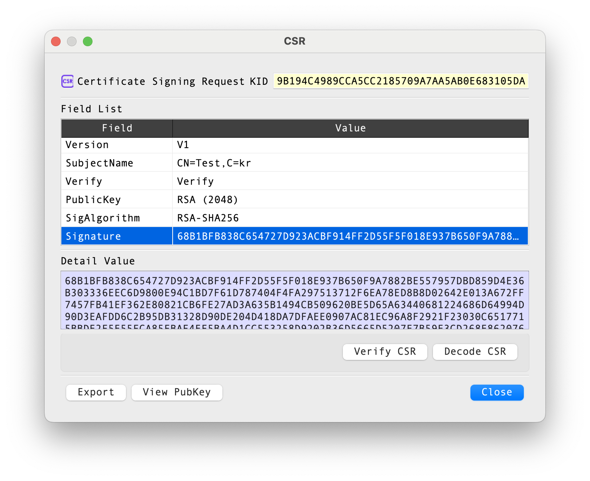

# CSR Information Dialog Guide

The **CSR Information** dialog displays the parsed fields of a certificate signing request (CSR), including its subject, public key, requested extensions, and signature information. It can also verify the CSR signature, decode the request in BerEditor, inspect the public key, and export the CSR.

*Figure 1. CSR Information dialog. The fields shown depend on the selected request.*

## Header and field list

The header identifies the object as a **Certificate Signing Request**. **KID** displays a key identifier derived from the CSR's public key when available.

The **Field List** is a read-only table of parsed request information. Select a row to show its value in **Detail Value**. For **PublicKey**, the detail area shows the key value. Available rows may include:

| Field | Description |
|---|---|
| Version | CSR structure version. |
| SubjectName | Distinguished name requested for the certificate. |
| Verify | The signature verification state read when the CSR is parsed. |
| PublicKey | Public key and, where applicable, its algorithm parameters. |
| SigAlgorithm | Algorithm used to sign the CSR. |
| Signature | CSR signature value. |
| Challenge / UnstructuredName | Optional request attributes when present. |
| Extensions | Requested certificate extensions, including their decoded values and criticality indicators. |

## Actions

| Control | Description |
|---|---|
| Verify CSR | Verifies the CSR's signature and reports whether verification succeeds. This checks the request signature; it does not validate a certificate or establish trust in the requester. |
| Decode CSR | Opens the encoded CSR in BerEditor's main data view. |
| View PubKey | Opens the public-key information dialog for the key contained in the request. |
| Export | Opens the export dialog for saving the CSR. |
| Close | Closes the CSR Information dialog. |

The verification controls may be disabled in an unlicensed installation.

## Review a CSR

1. Open the CSR information dialog from a CSR file or a CSR entry in BerEditor.
2. Review **SubjectName**, **PublicKey**, **SigAlgorithm**, and any requested extensions.
3. Select a field to inspect its full value in **Detail Value**. Use **View PubKey** for additional public-key details.
4. Select **Verify CSR** to check the request signature, or **Decode CSR** to inspect the encoded structure in the main view.
5. Select **Export** to save the CSR through the export dialog.
