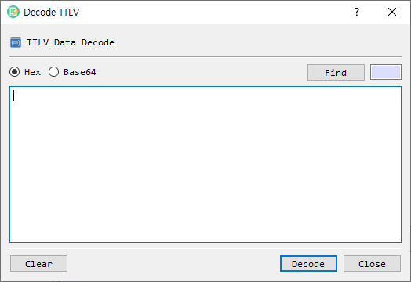

# Decode TTLV

The **Decode TTLV** dialog converts a TTLV message from hexadecimal or Base64 text and opens the decoded structure in BerEditor.

## Fields and controls

| Control | Description |
|---|---|
| Hex / Base64 | Selects how the text in the input area is interpreted. Hex is selected by default. |
| Find | Loads a binary data file into the input area using the selected representation. |
| Input area | Enter or paste the TTLV message. You can also drop a file onto the dialog. |
| Length | Displays the input data length for the selected format. |
| Clear | Clears the input area. |
| Decode | Parses the input as TTLV and sends the decoded data to the main BerEditor view. |
| Close | Closes the dialog. |

## Decode a message

1. Choose **Hex** or **Base64** to match the data you have.
2. Paste the message, or choose **Find** to load a file. You may also drop a file into the dialog.
3. Check the displayed length and select **Decode**.
4. Review the decoded TTLV structure in the main window.

If the input is empty or cannot be converted from the selected format, the dialog reports an error and keeps the input available for correction.
