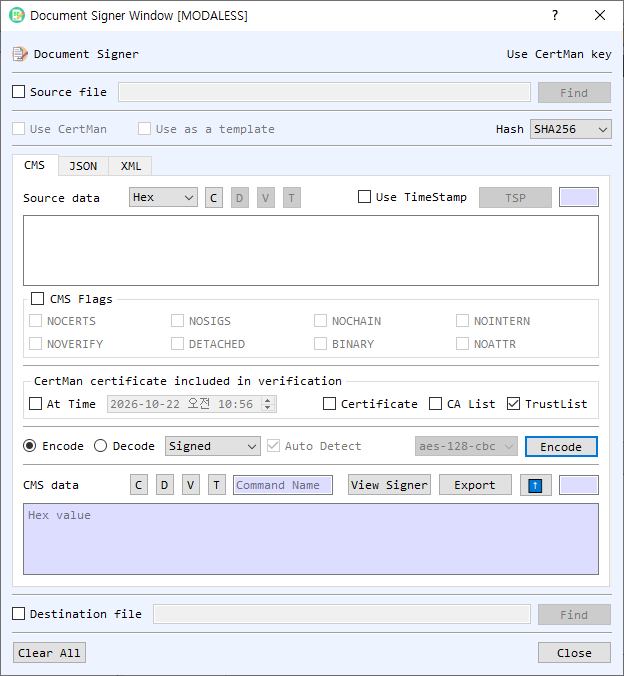

# Document Signer Dialog Guide

The **Document Signer** handles document signatures, verification, encryption, and data containers in CMS, JSON/JWS, and XML formats. It can work with text in the dialog or read and write source and destination files.

*Figure 1. Document Signer on the CMS tab in Encode mode. The JSON and XML tabs provide their own signing, verification, and encryption workflows.*

## Shared Controls

1. **Source file / Find** — Enable **Source file** to read the operation's input from a file. **Find** selects the file; a destination-file control at the bottom can select where to save output. Files may also be dragged into the dialog.
2. **Use CertMan / Use CertMan key** — Select whether to use key material from CertMan or, where available, KeyPairMan. The label indicates the active key source.
3. **Use as a template** — In XML workflows, use the supplied XML as a template for signing or encryption.
4. **Hash** — Select the hash algorithm where applicable.
5. **Clear All / Close** — Clear the dialog's input and output fields or close it.

## CMS Tab

- **Source data / CMS data** — Enter the content or CMS message. Select the source representation (**Hex**, **String**, or **Base64**). **C** clears the field; **V**, **D**, and **T** view, decode, or identify CMS data where available.
- **Use TimeStamp / TSP** — Attach a timestamp to supported signing operations. **TSP** configures the timestamp authority/service.
- **CMS Flags** — Configure `NOVERIFY`, `NOCERTS`, `NOSIGS`, `NOCHAIN`, `NOINTERN`, `DETACHED`, `BINARY`, and `NOATTR` for supported operations.
- **Certificate included in verification** — Configure **At Time**, **Certificate**, **CA List**, and **TrustList** for signed-message verification.
- **Encode / Decode and command** — Encode commands include **Signed**, **Enveloped**, **Add Signed**, **Data**, and **Digest**. Decode commands include **Verify**, **Developed**, **GetData**, and **GetDigest**. In Decode mode, **Auto Detect** dispatches based on the CMS type.
- **CMS data / Source data output** — Displays the created CMS message or processed content. **View Signer** inspects signer information; **Export** saves the output. The up-arrow copies output into the source field.

## Create or Process CMS Data

1. Select **Encode** or **Decode** and enter source data or load a file.
2. Select a command. **Signed** creates signed data; **Enveloped** encrypts content for a recipient; **Add Signed** adds a signer; **Data** wraps data; **Digest** creates digested data.
3. For signing or encryption, select the appropriate certificate/key. Choose the hash or cipher when enabled. Set timestamp and verification options as needed.
4. Select **Encode** or **Decode**. In Decode mode, leave **Auto Detect** on to identify supported CMS types or turn it off to choose a command.
5. Review the output and use **Export** or the destination file option to save it.

## JSON Tab (JWS)

The JSON tab works with a JSON payload and a JWS (JSON Web Signature) value. Enter or load the payload, then use **Compute Signature** to create a JWS or **Verify Signature** to validate one with the selected key. **Check Object** checks the JSON object. The payload and JWS controls provide view, clear, copy-to-input (up-arrow), and export actions.

## XML Tab

The XML tab accepts an XML body as text or a source file. Use **Check** to validate the XML input. Select signing or encryption mode to switch the actions between **Make / Verify** and **Encrypt / Decrypt**. The result area displays the generated signature or encrypted XML; use its up-arrow to reuse the result as the next body. **Use as a template** controls template-based input for XML operations. Select **Export** to save the result.

## Notes

- CMS encryption and decryption require a compatible recipient certificate and matching private key. Signing and verification require the appropriate signing key and certificate/trust settings.
- The Decode **Auto Detect** feature supports CMS Data, DigestedData, SignedData, and EnvelopedData.
- JSON signature operations require a compatible key and JWS algorithm. Verify that the key source matches the signing operation.
- XML signing and encryption require well-formed input; use **Check** before processing when needed.
- Protect private keys, passwords, and signed content. Verification outcomes depend on the selected certificate and trust configuration.
