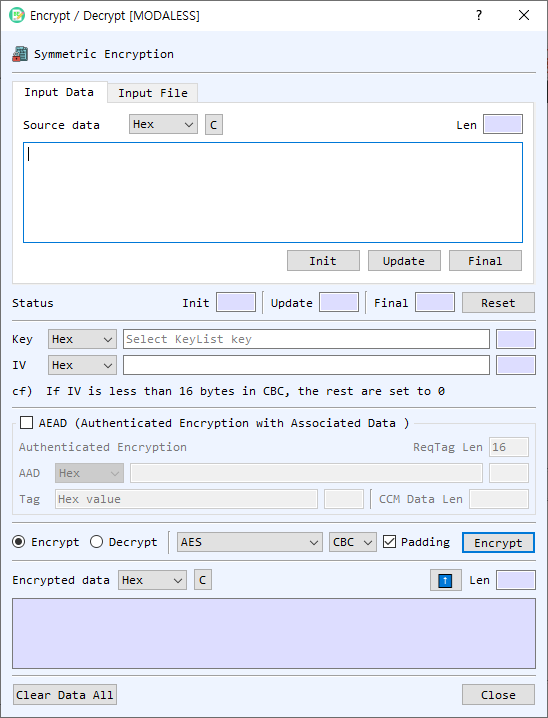

# Encrypt / Decrypt Dialog Guide

The **Encrypt / Decrypt** dialog performs symmetric encryption or decryption on entered data or a file. Open it from **Cryptography > Encrypt/Decrypt**.

*Figure 1. Encrypt / Decrypt dialog. This view shows input data mode, the AEAD section, and cipher settings.*

## Screen Areas

1. **Input Data / Input File** — Enter data directly or select a file to process.
2. **Source data** — Choose the input representation and enter or paste data. The **Len** field reports the decoded length. In file mode, use **Find** to select the source file and review its size and progress.
3. **Init / Update / Final / Reset** — Run the operation incrementally: initialize the cipher, process data blocks with Update, finish with Final, or reset the state.
4. **Key** — Select the key representation and enter a key, or leave it blank to choose a symmetric key from Key List. The length is shown beside the field.
5. **IV** — Select the IV representation and enter the initialization vector. The note in the dialog describes IV requirements for the selected mode.
6. **AEAD** — Enables authenticated encryption modes and associated data controls. Select **AAD** and enter additional authenticated data. The tag length, tag value, and CCM data length controls are used by the selected AEAD mode.
7. **Encrypt / Decrypt** — Choose the operation. The result field is labeled Encrypted data or Decrypted data accordingly.
8. **Algorithm / Mode** — Select a symmetric cipher and mode. Available modes depend on whether AEAD is selected and on the chosen algorithm.
9. **Padding** — Enables padding where supported by the selected algorithm and mode.
10. **Encrypt / Decrypt button** — Runs the selected operation on the current text or file.
11. **Result** — Displays the output in the selected representation. The length updates automatically. The up-arrow transfers the output into the input field and selects the matching representation.
12. **Clear Data All / Close** — Clears the dialog's data or closes the dialog.

## Encrypt or Decrypt Text

1. Select **Input Data** and choose the source data format.
2. Enter or paste the plaintext (for encryption) or ciphertext (for decryption).
3. Enter the key and IV, or select a key from Key List when prompted.
4. Choose **Encrypt** or **Decrypt**, then select the algorithm and mode.
5. For AEAD modes, enable **AEAD**, provide AAD if required, and set the tag parameters. For CCM, provide the data length requested by the dialog.
6. Select **Encrypt** or **Decrypt** to run the operation.
7. Review the result. Use the output format selector to view the result as Hex, String, or Base64.

## Process a File

1. Select **Input File**, then select **Find** and choose a source file.
2. Select or enter a destination file path using the destination-file controls.
3. Set the key, IV, operation, algorithm, and mode. Configure AEAD options if applicable.
4. Select **Encrypt** or **Decrypt** and monitor progress.

## Supported Modes and Notes

- Standard modes include **CBC**, **ECB**, **CTR**, **CFB**, and **OFB**.
- When **AEAD** is enabled, the available authenticated modes include **GCM** and **CCM**.
- **ChaCha20** and **ChaCha20-Poly1305** have mode and padding controls constrained by the cipher implementation.
- For AEAD decryption, provide the authentication tag associated with the ciphertext. Authentication failure prevents successful decryption.
- The input and output fields support Hex, String, and Base64 representations. Ensure the selected representation matches the text entered.

## Incremental Processing

For staged input, select **Init**, enter a block and select **Update** for each block, then select **Final**. The status fields show progress. Select **Reset** before starting a new operation.
