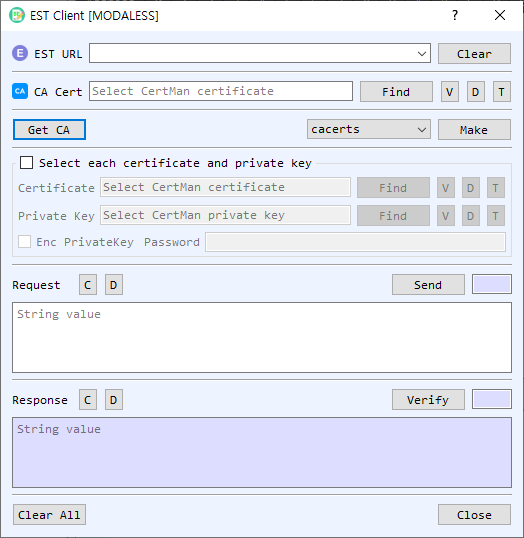

# EST Client Dialog Guide

The **EST Client** communicates with an Enrollment over Secure Transport (EST) server to retrieve CA certificates and prepare certificate enrollment requests.

*Figure 1. EST Client dialog with the `cacerts` operation selected. Choose a command, prepare or retrieve its request, send it, and inspect the response.*

## Screen Areas

1. **EST URL** — Enter or select the EST server base URL. **Clear** clears the saved URL list/input.
2. **CA Cert** — Select the CA certificate used for the EST exchange. **Find**, **V**, **D**, and **T** browse, view, decode, or identify the certificate.
3. **Get CA / Command / Make** — **Get CA** requests CA certificates from the server. Select an EST command and choose **Make** to prepare a request.
4. **Select each certificate and private key** — Enable this group to select client certificate/private-key files directly; otherwise use CertMan. Enable **Enc PrivateKey** and enter its password if the private key is encrypted.
5. **Request** — Displays the prepared EST request. **Send** transmits it to the server. **C** clears and **D** decodes the request.
6. **Response / Verify** — Displays the server response. **Verify** processes/verifies the response as supported by the selected command; **C** clears and **D** decodes it.
7. **Clear All / Close** — Clear dialog data or close the client.

## Commands

| Command | Purpose |
| --- | --- |
| `cacerts` | Retrieve the CA certificate collection using **Get CA**. |
| `simpleenroll` | Create a new key pair and CSR, then prepare a simple enrollment request. |
| `simplereenroll` | Use an existing certificate/key context and prepare a re-enrollment request with a new key/CSR. |
| `fullcmc` | Listed in the command selector; request generation is not implemented in this dialog. |
| `serverkeygen` | Listed in the command selector; request generation is not implemented in this dialog. |
| `csrattrs` | Listed in the command selector; request generation is not implemented in this dialog. |

## Prepare and Send an Enrollment Request

1. Enter the EST server URL and provide the CA certificate where needed.
2. Select **simpleenroll** and choose **Make**. Generate a key pair and complete the CSR information when prompted.
3. Select **Send** to submit the request. Review the response in the **Response** area.
4. For **simplereenroll**, select the existing certificate/private key or choose them from CertMan before preparing the request. The client generates a new key and CSR based on the existing certificate identity.
5. If issued material is returned, follow the prompt to save the private key and certificate to CertMan.

## Notes

- The dialog implementation currently reports **fullcmc**, **serverkeygen**, and **csrattrs** request generation as unsupported.
- Keep the CA certificate and enrollment credentials consistent with the EST server configuration.
- Private keys are sensitive. If the selected private key is encrypted, enable **Enc PrivateKey** and provide its password.
