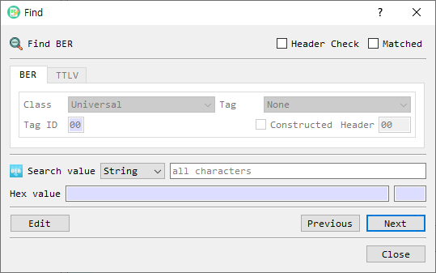

# Find in BER or TTLV Data

The **Find** dialog searches the currently open BER or TTLV structure for a value. BerEditor enables the matching tab based on the format currently open in the main window.

## Search options

| Control | Description |
|---|---|
| BER / TTLV tabs | Select the data format. The active document determines which tab is available. |
| Header Check | Enables the header filters. When unchecked, the search matches values regardless of their headers. |
| Matched | Limits the search to an exact value match. |
| Search value | Enter the value to find. |
| Value format | Selects the input representation. BER searches support String, Hex, Decimal, and OID; TTLV searches support String, Hex, and Decimal. |
| Hex value | Shows the converted hexadecimal bytes for the search value. Its length is displayed beside it. |
| Next / Previous | Searches forward or backward from the current selection. |
| Edit | Opens the selected BER or TTLV node for editing. |
| Close | Closes the dialog. |

## BER header filters

With **Header Check** enabled on the BER tab, configure the optional header criteria:

- **Class:** Universal, Application, Content-Specific, or Private.
- **Tag:** Select a standard BER tag for Universal class. For other classes, enter a tag ID.
- **Constructed:** Match constructed values when selected.
- **Header:** Displays the generated one-byte BER header used by the search.

## TTLV header filters

With **Header Check** enabled on the TTLV tab, enter a six-digit hexadecimal **Tag** and select a **Type**. The tag name is shown when recognized. **Any** searches all TTLV types for that tag; otherwise the generated header includes the selected type.

## Search

1. Open the BER or TTLV data in the main window. The dialog activates the corresponding tab.
2. Enter the value and choose its format. The hexadecimal representation updates as you type.
3. Optionally enable **Header Check** and set BER or TTLV header criteria. Enable **Matched** for exact matching.
4. Select **Next** or **Previous** to move to a matching node. The node is selected in the main view.
5. Select **Edit** to edit the selected node, or **Close** to dismiss the dialog.

If the value cannot be converted or no matching node exists, BerEditor displays a warning.
