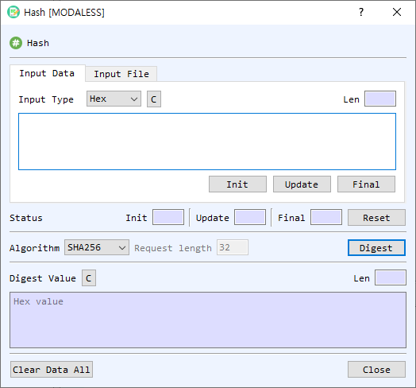

# Hash Dialog Guide

The **Hash** dialog calculates a digest for text or a file. Open it from **Cryptography > Hash**.

*Figure 1. Hash dialog on the Input Data tab. Select a source, choose a hash algorithm, and select Digest to calculate the digest.*

## Screen Areas

1. **Input Data / Input File** — Choose whether to enter data directly or hash a file.
2. **Input Type** — Select how the input text is represented (for example, Hex, String, or Base64).
3. **Input area / Input File controls** — Enter text in Input Data, or select **Find** in Input File to choose a file. File mode displays file information, total and read sizes, and progress.
4. **Init / Update / Final** — Run a hash incrementally: initialize the selected algorithm, add the current input to the hash state, then finalize and display the digest. **Reset** clears the incremental operation status.
5. **Status** — Shows the state of the incremental operation.
6. **Algorithm** — Select the hash algorithm. The list is provided by the application and may depend on the build and crypto configuration.
7. **Request length** — Sets the output length for SHAKE128 or SHAKE256. It is disabled for fixed-length hash algorithms. The default is 32 bytes.
8. **Digest** — Calculates a one-shot digest for the selected input data or file.
9. **Digest Value** — Displays the digest in hexadecimal. Its **Len** field shows the output length. **C** clears the digest.
10. **Clear Data All** — Clears input, output, and status fields.
11. **Close** — Closes the dialog.

## Calculate a Digest from Text

1. Select **Input Data**.
2. Choose the **Input Type** and enter or paste the data.
3. Select a hash **Algorithm**.
4. For SHAKE128 or SHAKE256, enter the desired **Request length** in bytes.
5. Select **Digest**. The digest appears in hexadecimal in **Digest Value**.

## Calculate a Digest from a File

1. Select **Input File**.
2. Select **Find** and choose a file.
3. Review the file information and select the threading option if shown.
4. Select **Digest** and wait for the progress indicator to complete.

The dialog reads the file in blocks and updates the read size and progress. Large files can be processed without loading the entire file into the input text area.

## Incremental Hashing

Use **Init**, **Update**, and **Final** when you want to feed data to the hash operation in stages:

1. Select an algorithm and choose **Init**.
2. Enter a data block and select **Update**. Repeat for additional blocks.
3. Select **Final** to calculate and display the digest.
4. Select **Reset** to clear the operation state before starting another sequence.

## Notes

- The input length and digest length are displayed automatically.
- Use the same algorithm and input bytes when reproducing or comparing a digest.
- An empty input is allowed for one-shot digest calculation; it produces the digest of the empty byte sequence.
