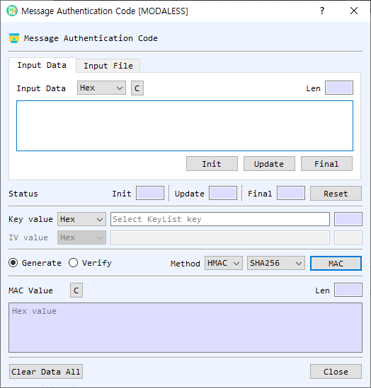

# Message Authentication Code (MAC) Dialog Guide

The **Message Authentication Code** dialog generates or verifies a MAC over text or file data. Open it from **Cryptography > Message Authentication Code**.

*Figure 1. Message Authentication Code dialog. Choose a source, key, method, and algorithm; then generate a MAC or verify a supplied value.*

## Screen Areas

1. **Input Data / Input File** — Choose to enter message data directly or select a file.
2. **Input Type** — Select the representation for the message input (for example, Hex, String, or Base64). In file mode, **Find** selects a file and the dialog shows file information and processing progress.
3. **Init / Update / Final / Reset** — Provide incremental MAC processing controls. Init starts the operation, Update feeds the current input, Final completes it, and Reset clears the incremental status.
4. **Key value** — Enter the MAC key and select its representation. If left empty, the dialog offers the symmetric Key List for selecting a key. The length field is calculated automatically.
5. **IV value** — Enter the initialization vector for GMAC. It is disabled for HMAC and CMAC. Select its representation as needed.
6. **Generate / Verify** — Select whether to create a MAC or verify an expected MAC value.
7. **Method** — Select **HMAC**, **CMAC**, or **GMAC**.
8. **Algorithm** — For HMAC, select a hash algorithm. For CMAC and GMAC, select a symmetric cipher algorithm.
9. **MAC / Verify** — Runs the selected operation on the current text or file input.
10. **MAC Value** — In Generate mode, displays the resulting MAC in hexadecimal. In Verify mode, enter the expected MAC value here as hexadecimal. The **Len** field shows its length.
11. **Status** — Shows Init, Update, and Final results. **Reset** clears the incremental operation state.
12. **Clear Data All** — Clears input, key, IV, output, file information, and status.
13. **Close** — Closes the dialog.

## Generate a MAC from Text

1. Select **Input Data** and enter the message data using the selected **Input Type**.
2. Enter the key and choose its representation, or leave the key empty and select one from the symmetric Key List when prompted.
3. Select a **Method** and **Algorithm**.
4. For **GMAC**, enter an IV. HMAC and CMAC do not use the IV field.
5. Select **Generate**.
6. Select **MAC**. The generated MAC is displayed in hexadecimal in **MAC Value**.

## Verify a MAC from Text

1. Enter the message data, key, method, and algorithm as described above.
2. For GMAC, enter the IV used to generate the expected value.
3. Select **Verify**.
4. Enter the expected MAC in **MAC Value** as hexadecimal.
5. Select **Verify** to calculate and compare the value. The status or message box reports whether verification succeeded.

## Process a File

1. Select **Input File**, select **Find**, and choose the file.
2. Select the method, algorithm, key, and (for GMAC) IV.
3. Select **Generate** or **Verify**, then select the operation button.
4. Monitor the progress and read-size indicators while the file is processed.

## Methods

| Method | Algorithm selection | IV |
| --- | --- | --- |
| **HMAC** | Hash algorithm | Not used |
| **CMAC** | Symmetric cipher algorithm | Not used |
| **GMAC** | Symmetric cipher algorithm | Required |

## Incremental Processing and Notes

- **Init**, **Update**, and **Final** can be used to process data in stages. Enter a block in the input area and select **Update** for each block, then select **Final**.
- The key and IV length fields update automatically.
- Use matching message data, key, method, algorithm, and IV when verifying a MAC.
- Keep the key secret. Anyone with the key can generate valid MAC values.
