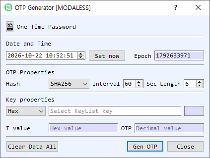

# OTP Generator Dialog Guide

The **OTP Generator** creates a time-based one-time password (OTP) from a symmetric key, a selected time, a hash algorithm, and a time interval.

*Figure 1. OTP Generator dialog. Set the timestamp and OTP parameters, provide the shared key, then generate the code.*

## Screen Areas

1. **Date and Time** — Select the timestamp used for generation. **Set now** fills in the current local time.
2. **Epoch** — Shows the selected date and time as Unix time in seconds. It updates when the date/time changes.
3. **Hash** — Select the hash algorithm used to generate the OTP. The initial selection follows BerEditor's configured default hash.
4. **Interval** — Set the time-step duration in seconds. The default is 60 seconds.
5. **Length** — Set the number of decimal digits in the OTP. The default is 6 digits.
6. **Key properties** — Select the key representation (**Hex**, **String**, or **Base64**) and enter the shared secret key. The adjacent field shows its length. If the key field is empty when generating, the dialog opens KeyList so you can select a symmetric key.
7. **T value** — Displays the time-step value used for this generation, in hexadecimal.
8. **OTP** — Displays the generated password as decimal digits.
9. **Gen OTP / Clear Data All / Close** — Generate the OTP, clear the key and result fields, or close the dialog.

## Generate an OTP

1. Set **Date and Time**, or select **Set now** to use the current time. Confirm the corresponding **Epoch** value.
2. Choose the **Hash**, **Interval**, and OTP **Length** expected by the other system or authenticator.
3. Enter the shared secret in **Key properties** and choose its representation. If left blank, select a key from KeyList when prompted.
4. Select **Gen OTP**. The time-step value and decimal OTP appear in their result fields.

## Notes

- OTP verification requires matching parameters on both sides, including the shared secret, hash, time interval, and code length. Clock differences can cause a code to be rejected.
- The generated OTP is associated with the selected timestamp and interval; use **Set now** when generating a code for the current time.
- Treat the shared key as sensitive. The generation details, including the key and OTP, are also written to BerEditor's log.
- **Clear Data All** clears the key and result values. It does not change the selected time or OTP parameters.
