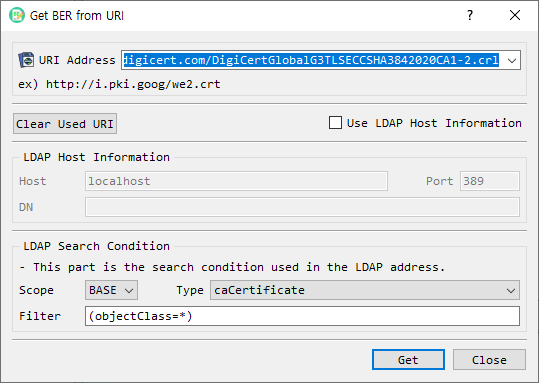

# Get BER from URI Dialog Guide

The **Get BER from URI** dialog retrieves BER-encoded data from an HTTP(S) or LDAP address and loads the result into the main BerEditor window for decoding. Open it from **Tool > Get BER from URI**.

*Figure 1. Get BER from URI dialog. Enter an HTTP(S) or LDAP address, or enable LDAP Host Information to supply LDAP connection and search details separately.*

## Screen Areas

1. **URI Address** — Enter or select an address. Recent addresses are available from the drop-down list. The dialog accepts `http`, `https`, and `ldap` schemes.
2. **Example** — Shows an example certificate URL.
3. **Clear Used URI** — Removes the saved recent URI list.
4. **Use LDAP Host Information** — Switches from a full URI to separately entered LDAP connection details. When enabled, the URI field is disabled and the LDAP Host Information group is enabled.
5. **LDAP Host Information** — Enter the LDAP server **Host**, **Port**, and search **DN**. The host and port are retained as settings for later use.
6. **LDAP Search Condition** — Supplies LDAP search options: **Scope**, certificate **Type**, and **Filter**. The default filter is `(objectClass=*)`.
7. **Get** — Retrieves data from the selected address and asks BerEditor to decode the returned data.
8. **Close** — Closes the dialog.

## Retrieve Data from an HTTP(S) URI

1. Leave **Use LDAP Host Information** unchecked.
2. Enter or select an `http://` or `https://` address in **URI Address**.
3. Select **Get**.
4. If retrieval succeeds, BerEditor decodes the returned data in the main window and displays a success message.

The address can also be selected from the recent URI list. Successfully used addresses are saved in that list. **Clear Used URI** removes the saved list.

## Retrieve Data from LDAP

You can provide LDAP details in either of these ways:

### Use an LDAP URI

1. Leave **Use LDAP Host Information** unchecked.
2. Enter an `ldap://` URI that identifies the LDAP server and search location.
3. Set the search **Type** and **Filter** if needed.
4. Select **Get**.

The dialog reads the server, DN, scope, filter, and requested attribute from the LDAP URI when those values are present. The selected **Type** and filter field are used as defaults where the URI does not specify them.

### Enter LDAP Host Information Separately

1. Select **Use LDAP Host Information**.
2. Enter the LDAP server **Host**, **Port**, and **DN**.
3. Choose a **Scope**, **Type**, and **Filter**.
4. Select **Get**.

The current implementation provides the `BASE` scope. Available certificate types are `caCertificate`, `signCertificate`, `userCertificate`, `certificateRevocationList`, `autorithRevocationList`, `deltaRevocationList`, and `certificateTrustList`.

## Troubleshooting

- Enter an address before selecting **Get**. The dialog reports an error when the URI is empty or uses an unsupported scheme.
- For LDAP host mode, provide a DN. Check the host, port, and server availability if connection or bind errors appear.
- If retrieval fails, BerEditor reports the retrieval error in a warning or log message.
- Retrieved data is passed to the main BER decoder. If the server returns data that is not valid BER, decoding may fail even when the network request succeeds.
