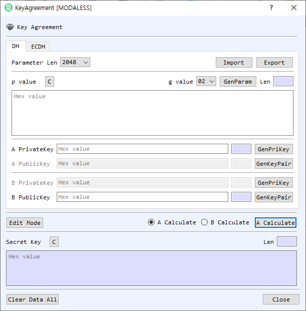

# Key Agreement Dialog Guide

The **Key Agreement** dialog calculates a shared secret using Diffie–Hellman (DH) or Elliptic Curve Diffie–Hellman (ECDH). It can also generate the parameters and key material used in the calculation.

*Figure 1. Key Agreement dialog with the DH tab selected. The ECDH tab provides equivalent key agreement controls for elliptic-curve keys.*

## Screen Areas

1. **DH / ECDH tabs** — Select finite-field DH or elliptic-curve ECDH.
2. **DH parameters** — In the **DH** tab, choose **Parameter Len**, select the **g value** (generator), and enter the **p value** (prime modulus) as hexadecimal. **GenParam** generates DH parameters. **Import** and **Export** load and save DH parameters.
3. **A and B keys** — Enter each participant's private and public keys in hexadecimal. Use **GenPriKey** to generate a private key and **GenKeyPair** to generate a key pair. The public key is derived from the corresponding private key and DH/ECDH parameters.
4. **ECDH parameters and key tools** — In the **ECDH** tab, choose a curve or parameter set. The adjacent field displays its identifier. The A and B key areas provide controls to generate or check keys, find a private-key file, or retrieve keys from CertMan or KeyPairMan.
5. **Edit Mode** — Enables editing of all A/B private and public key fields. In calculation mode, only the fields needed for the selected participant are enabled.
6. **A Calculate / B Calculate** — Select which participant computes the shared secret. **Run** performs that calculation.
7. **Display shared key Y value** — For ECDH, also display the Y component of the computed shared point when available. The shared secret's X component is shown by default.
8. **Secret Key** — Displays the calculated result in hexadecimal and its length. **C** clears this output.
9. **Clear Data All / Close** — Clear the dialog's values or close the dialog.

## Calculate a DH Shared Secret

1. Select the **DH** tab.
2. Choose a parameter length and generator, or enter/import the agreed **p** and **g** values. Both participants must use the same parameters.
3. Enter or generate A's and B's private/public keys. For A's calculation, provide **A PrivateKey** and **B PublicKey**. For B's calculation, provide **B PrivateKey** and **A PublicKey**.
4. Select **A Calculate** or **B Calculate**, then select **Run**.
5. Read the resulting shared value in **Secret Key**. The dialog also writes calculation details to BerEditor's log.

## Calculate an ECDH Shared Secret

1. Select the **ECDH** tab and choose the same curve or parameter set used by both participants.
2. Enter or generate the participant key pairs. To calculate as A, provide **A PrivateKey** and **B PublicKey**; to calculate as B, provide **B PrivateKey** and **A PublicKey**.
3. Select the calculation side and choose **Run**.
4. Read the shared secret in **Secret Key**. Enable **Display shared key Y value** if you also need the Y component shown.

## Generate and Import Parameters or Keys

- In the **DH** tab, select a parameter length and use **GenParam** to create parameters. Use **Export** to save them or **Import** to load existing parameters.
- Use **GenPriKey** and **GenKeyPair** to create DH key material. The private key and public key must belong to the same participant and parameters.
- In the **ECDH** tab, select the desired curve before generating keys. The **FindPriKey**, **GetFromCertMan**, and **GetFromKeyPair** controls can load existing private/public key material. The check controls validate the displayed public key or key pair.

## Notes

- A and B must use the same DH parameters or ECDH curve, and each side must calculate with its own private key and the other side's public key. Both calculations should produce the same shared secret.
- Values entered directly in the key and parameter fields use hexadecimal encoding.
- **Edit Mode** is useful when preparing both participants' values manually; the normal A/B calculation selection enables the inputs required for that calculation.
- Treat private keys and shared secrets as sensitive data. Clear the fields when finished if the dialog should not retain them.
