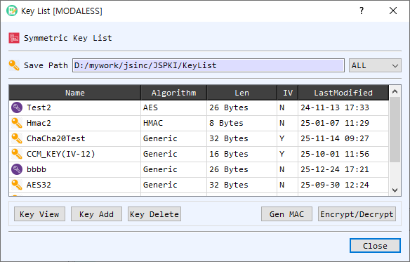

# KeyList Dialog Guide

The **Symmetric Key List** dialog stores and selects symmetric keys used by BerEditor's encryption, decryption, and MAC tools. The list displays each key's name, algorithm, length, IV availability, and last-modified time.

*Figure 1. Key List in management mode. Select a row to view, delete, or use the stored key.*

## Screen Areas

1. **Save Path** — Shows the configured key-list storage folder. The adjacent filter shows **All** keys or narrows the list by algorithm, including generic keys and HMAC keys.
2. **Key table** — Lists stored keys with **Name**, **Algorithm**, **Len**, **IV**, and **LastModified** columns. **IV** indicates whether an initialization vector is associated with the entry. Select a row before using an action.
3. **Key View** — Opens the selected key entry for inspection.
4. **Key Add** — Opens the key editor to create a named key entry. Enter its algorithm, key value, and optional IV.
5. **Key Delete** — Removes the selected key entry from the configured key-list folder.
6. **Gen MAC** — Opens the MAC generator using the selected key.
7. **Encrypt/Decrypt** — Opens the symmetric encryption/decryption tool using the selected key.
8. **OK / Close** — In selection mode, **OK** returns the selected key (and associated IV where applicable) to the calling dialog. **Close** dismisses the key list.

## Add or Inspect a Key

1. Select **Key Add** and enter a unique key name, algorithm, key value, and optional IV in the key editor.
2. Save the entry. It appears in the table with its algorithm, length, IV indicator, and modification time.
3. Select a row and choose **Key View** to inspect the stored entry. In management mode, right-click a row for the view and delete actions.

## Select a Key for Another Tool

1. Open KeyList from the dialog that needs a symmetric key.
2. Optionally filter by algorithm, then select the desired key row.
3. Select **OK** or double-click the row to return the key to the calling dialog.

## Notes

- A key entry's name must be unique within the configured key-list folder.
- The key list supports algorithm-specific and generic key entries, as well as HMAC keys. The caller may filter the list to a specific algorithm.
- Treat stored symmetric keys and IV values as sensitive. Deleting an entry removes its file from the key-list folder.
