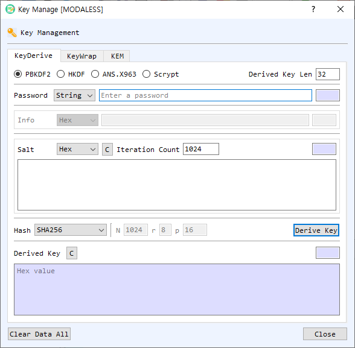

# Key Management Dialog Guide

The **Key Management** dialog provides three tools: key derivation, symmetric key wrapping/unwrapping, and key encapsulation. Open it from **Cryptography > Key Manage**.

*Figure 1. Key Management dialog on the KeyDerive tab. The dialog also contains KeyWrap and KEM tabs.*

## Tabs

| Tab | Purpose |
| --- | --- |
| **KeyDerive** | Derives a key using PBKDF2, HKDF, ANS X9.63, or Scrypt. |
| **KeyWrap** | Wraps or unwraps key bytes using KW or KWP and a key-encryption key (KEK). |
| **KEM** | Encapsulates a shared key using a public key or decapsulates it using the matching private key. |

## Key Derivation

1. Open **KeyDerive** and select a derivation method.
2. Enter the password or secret and choose its input representation where available.
3. Enter method-specific salt and information values, and select a hash where applicable.
4. Set the desired **Derived Key Len** in bytes and any method parameters.
5. Select **Derive Key**. The derived key is displayed as hexadecimal.

| Method | Main inputs |
| --- | --- |
| **PBKDF2** | Password (String), salt, iteration count, hash, and key length. |
| **HKDF** | Secret, salt, optional Info, hash, and key length. A salt is required by this dialog. |
| **ANS.X963** | Secret, Info, hash, and key length. |
| **Scrypt** | Password, salt, N/r/p parameters, and key length. The hash and Info controls are not used. |

The input type selectors for secret, salt, and Info use the available data formats shown by the dialog, such as Hex, String, and Base64. Length fields are calculated automatically. Use the salt **C** button or the derived-key **C** button to clear those fields. **Clear Data All** clears the dialog's derivation, wrapping, and KEM data.

## Key Wrap and Unwrap

1. Open **KeyWrap** and choose **KW** or **KWP** under **Method**.
2. Choose **Wrap** or **Unwrap**.
3. Enter the source key (for Wrap) or wrapped key (for Unwrap). Select the input representation.
4. Enter the **KEK** and its representation, or use **Gen KEK** to generate an AES key of the selected length (16, 24, or 32 bytes).
5. Select **Run**. The result is shown in hexadecimal.

In Wrap mode, the result is the **Wrapped Key**. In Unwrap mode, the result is the recovered **Source key**. The up-arrow button moves the result into the source field for another operation. In KW mode, the source key must be at least 16 bytes. KWP supports padding for inputs that do not meet the KW block-size requirement.

## Key Encapsulation (KEM)

KEM uses a public key to generate a shared key and an encapsulated value, then uses the matching private key to recover the same shared key.

### Encapsulate

1. Open **KEM** and select **Encapsulate**.
2. Choose the public key source: select **Use CertMan** to select from certificate management, or enable **Select private key or public key** and provide a certificate or public key file.
3. Select **Encapsulate**. The generated shared key and wrapped/encapsulated key are shown as hexadecimal values.

### Decapsulate

1. Select **Decapsulate**.
2. Choose the private key source: **Use CertMan**, or enable **Select private key or public key** and provide a private key file.
3. If the private key file is encrypted, select its encrypted-key option and enter the password.
4. Enter the encapsulated value in **Wrapped Key** and select **Decapsulate**.
5. The recovered shared key appears in the key output field.

The KEM operation supports RSA, ECDSA, and ML-KEM key types in the current implementation. The key and encapsulated-value fields provide **Find**, **View**, **Decode**, or **Type** actions for the selected file, where available. Clear buttons remove the corresponding values.

## Troubleshooting

- Check that the selected representation matches the entered text. Invalid Hex or Base64 input prevents the operation.
- Key derivation requires a password or secret. HKDF also requires a salt.
- Key wrapping requires both source data and a KEK. KW requires a source key of at least 16 bytes.
- KEM encapsulation requires a supported public key or certificate; decapsulation requires the matching supported private key and encapsulated value.
- Operation failures are reported in a warning, and activity details may also appear in the BerEditor log.
