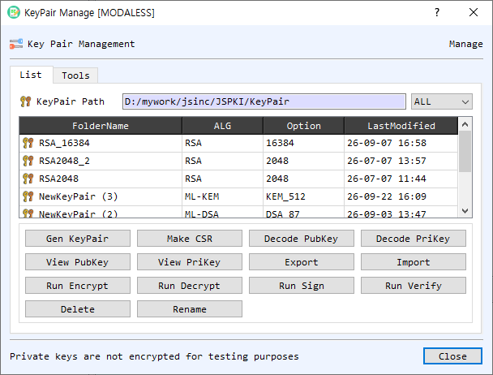

# KeyPairMan Dialog Guide

The **Key Pair Management** dialog stores, selects, inspects, and uses asymmetric key pairs in BerEditor's KeyPairMan. A key pair is shown with its algorithm, parameter set, and modification time.

*Figure 1. KeyPairMan on the List tab. Select a key-pair row to perform an action on that key.*

## Screen Areas

1. **List / Tools tabs** — **List** manages stored key pairs. **Tools** works with private keys, public keys, encrypted private keys, private-key information, and certificate signing requests (CSRs).
2. **KeyPair Path** — Shows the configured KeyPairMan storage folder. The adjacent filter limits listed key pairs by algorithm or shows **All**.
3. **Key-pair table** — Lists stored pairs by folder name, algorithm, option/parameter, and last-modified time. Select a row before using the action buttons.
4. **Gen KeyPair / Import** — Generate a new pair or import key material into KeyPairMan.
5. **View PubKey / View PriKey** — Inspect the selected pair's public or private key. Private key material is sensitive.
6. **Decode PubKey / Decode PriKey** — Decode the selected key in BerEditor's main window.
7. **Run Encrypt / Run Decrypt / Run Sign / Run Verify** — Open the corresponding operation using the selected key material.
8. **Make CSR** — Create a certificate signing request using the selected key pair.
9. **Export / Delete / Rename** — Export the selected pair, remove it from KeyPairMan, or change its name.
10. **Tools tab controls** — Load private/public key files, inspect or decode them, check that a pair matches, create a CSR, save a pair to the list, and encrypt/decrypt a private key. The private-key encryption mode and password are set in this tab.
11. **Save as DER** — Select DER output for supported export/save operations in the Tools tab.
12. **OK / Close** — **OK** confirms selection when the dialog is being used to choose a key pair. **Close** dismisses the manager.

## Manage Key Pairs

1. Open the **List** tab and select a row, or choose **Gen KeyPair** or **Import** to add key material.
2. Use **View**, **Decode**, or **Make CSR** to inspect or prepare the selected pair.
3. Use the Run buttons to launch encryption, decryption, signing, or verification with the selected key.
4. Use **Export**, **Rename**, or **Delete** as needed. Deleting removes the stored key-pair entry from KeyPairMan.

## Use the Tools Tab

1. Open **Tools** and use **Find** beside the private-key or public-key field to select files. The **V**, **D**, and **T** controls view, decode, or identify key data where available.
2. Select **Check KeyPair** to confirm the public and private keys correspond.
3. Select **Make CSR** to create a request from the key pair, then inspect or decode the CSR as needed.
4. Select **Save to List** to add the pair to KeyPairMan.
5. To protect or unlock a private key, provide an encrypted private-key file or key, choose an encryption mode and password, then use **Encrypt PrivateKey** or **Decrypt PrivateKey**.

## Notes

- The dialog displays a notice that private keys in KeyPairMan are not encrypted for testing purposes. Protect the storage directory and exported key files accordingly.
- Run operations require a compatible key type and the appropriate public or private key component.
- KeyPairMan paths are configured in BerEditor settings; the path shown in the dialog identifies the active store.
