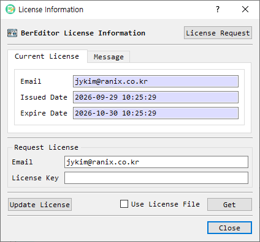

# License Information

The **License Information** dialog displays BerEditor's current license status and provides controls to request, load, update, or remove license information.

## Message tab

The **Message** tab reports whether BerEditor is licensed. In unlicensed mode, it may show a notice about an expired or missing license. **Do stop showing this message for the time being** suppresses the notice temporarily; clear it to resume the notices.

## Current License tab

| Field or control | Description |
|---|---|
| Email | Email associated with the current license. |
| Issued Date | License issue date and time. |
| Expire Date | License expiration date and time. |
| License Request | Opens the license registration page in the system browser. |
| Email / License Key | Credentials used when retrieving a license. |
| Get | Retrieves and applies a license using the entered email and license key. |
| Use License File | Switches to selecting a local license file; the **Get** button changes to **Find**. |
| Free License | Requests a free license for the entered email address. |
| Update License | Updates the current license when the service is available. |
| Remove | Removes invalid saved license information after confirmation. |
| Close | Closes the dialog. |

The available buttons depend on the current license state. For example, **Update License** is shown for a valid licensed installation, while **Free License** is offered when no valid license is active.

## Apply a license

1. To request a license, select **License Request** and follow the registration page instructions.
2. Return to BerEditor. Enter the email and license key, then select **Get**; or enable **Use License File** and select **Find** to load a license file.
3. To request a free license, enter an email address and select **Free License**, then confirm.
4. If the license changes successfully, accept the restart prompt to apply it.

Use **Update License** to renew an existing license when that action is available. **Remove** is intended for invalid saved license information. Close the dialog when finished.
