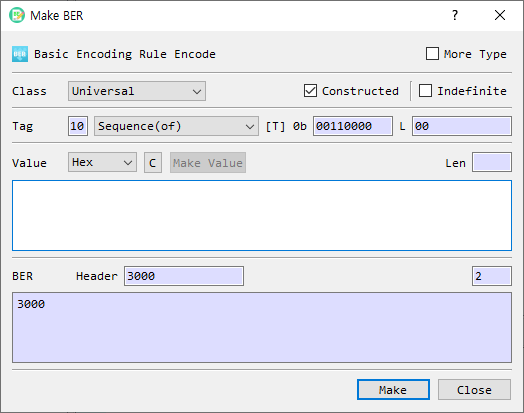

# Make BER Dialog Guide

The **Make BER** dialog builds a BER-encoded value from a tag and value. Open it from **Tool > Make BER**.

*Figure 1. Make BER dialog. The header and BER output are updated as the tag settings and value change.*

## Screen Areas

1. **More Type** — Adds additional universal tag types to the Tag type list.
2. **Class** — Selects the BER tag class: **Universal**, **Application**, **Content-Specific**, or **Private**.
3. **Constructed** — Sets the constructed bit. **SEQUENCE** and **SET** are always constructed; other universal types cannot be changed to constructed in this dialog.
4. **Indefinite** — Uses indefinite length for constructed data. This option is enabled only when Constructed is selected. The generated BER ends with the end-of-contents marker `00 00`.
5. **Tag / Number** — For the Universal class, select a tag type from the list. For the other classes, enter the tag number in hexadecimal. The tag number for Content-Specific is limited to `1F` (31) or less in this dialog.
6. **Tag bits** — Shows the BER tag byte in binary (`[T] 0b`).
7. **L** — Shows the generated length field in hexadecimal.
8. **Value format and input** — Select the input representation and enter the value. Available formats are **Hex**, **String**, and **Base64**. The **Len** field shows the decoded value length.
9. **C** — Clears the value input.
10. **Make Value** — Opens a helper for supported value types such as BitString, Integer, or ObjectIdentifier. Availability depends on the selected tag and value format.
11. **BER Header** — Displays the generated tag and length bytes in hexadecimal.
12. **BER output** — Displays the complete BER value in hexadecimal. Its **Len** field shows the output length.
13. **Make** — Validates and accepts the generated BER value. From **Tool > Make BER**, the value is then loaded into the main BER view.
14. **Close** — Closes the dialog without accepting the generated value.

## Create a BER Value

1. Open **Tool > Make BER**.
2. Choose a **Class**.
3. For **Universal**, choose a tag type. Use **More Type** if the required universal type is not in the initial list. For another class, enter the tag **Number** in hexadecimal.
4. Set **Constructed** or **Indefinite** if applicable. These controls are constrained by the selected tag class and type.
5. Select the value format, then enter the value. The BER Header and BER output update as you edit the settings.
6. Review the header, length, and complete BER output.
7. Select **Make** to validate and load the result into the main BER view.

## Tag and Value Notes

- The default universal tag is **SEQUENCE**, with Constructed enabled.
- **NULL** has no value input; the value field is disabled for this tag.
- **SEQUENCE** and **SET** require the Constructed bit. Other universal tag types are treated as primitive by this dialog.
- For a constructed value with **Indefinite** selected, the BER output uses an indefinite length and appends `00 00` as the end-of-contents marker.
- A BER **BOOLEAN** value must be exactly one byte.
- For **BIT STRING**, the first value byte must be between `00` and `07`, representing the number of unused bits.
- For non-universal classes, enter the tag number in hexadecimal. The Content-Specific class uses a low tag number up to `1F` here.

## If Validation Fails

If the selected input format cannot be decoded, BerEditor reports a format error and returns focus to the value field. Correct the input format or value, then select **Make** again. Boolean and BitString values have the additional constraints listed above.
