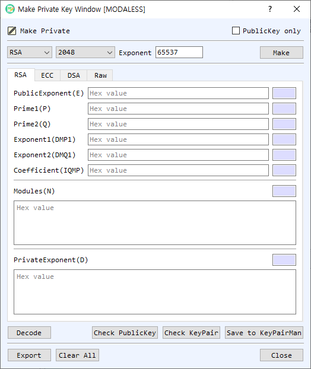

# Make Private Key Dialog Guide

The **Make Private Key** dialog generates asymmetric key pairs and displays their components. It supports RSA, ECC, DSA, and raw-key algorithms, including EdDSA and post-quantum ML-KEM, ML-DSA, and SLH-DSA.

*Figure 1. Make Private Key dialog with RSA selected. Use the algorithm tabs to view or edit the corresponding key components.*

## Screen Areas

1. **Algorithm** — Select the key algorithm: RSA, ECDSA, SM2, DSA, EdDSA, ML-KEM, ML-DSA, or SLH-DSA. The available parameter choices depend on the algorithm.
2. **Parameter** — Choose the key size, curve, or algorithm parameter set. For RSA, the default size is 2048 bits. Other algorithms use their respective sizes or named parameter sets.
3. **Exponent** — Set the RSA public exponent as a decimal value. The default is `65537`; this setting applies to RSA key generation.
4. **PublicKey only** — When enabled, the dialog generates or exports only public-key data and disables private-key components where applicable.
5. **RSA tab** — Shows RSA public exponent **E**, primes **P** and **Q**, modulus **N**, private exponent **D**, CRT exponents **DMP1** and **DMQ1**, and coefficient **IQMP**. Values are hexadecimal; adjacent fields show their lengths.
6. **ECC tab** — Shows the selected curve name and OID, private key, and public point coordinates **PubX** and **PubY**.
7. **DSA tab** — Shows the domain parameters **P**, **Q**, and **G**, plus the public and private key values.
8. **Raw tab** — Select the raw algorithm **Name** and **Param** set, then view the raw public and private key values. Raw algorithms include EdDSA, ML-KEM, ML-DSA, and SLH-DSA.
9. **Make** — Generates a key pair using the selected algorithm and parameters, then fills the corresponding tab with the generated components.
10. **Decode / Check PublicKey / Check KeyPair** — Decode the displayed key in BerEditor, validate the public key, or validate the key pair. These controls use the currently selected key tab.
11. **Save to KeyPairMan** — Save the generated key pair to BerEditor's KeyPairMan, when the displayed key data is valid and complete.
12. **Export** — Export the key material from the current tab. The **PublicKey only** setting determines whether public or private key data is selected for export.
13. **Clear All / Close** — Clear the key component fields or close the dialog.

## Generate a Key Pair

1. Select the desired **Algorithm**.
2. Choose its **Parameter**. For RSA, set the key size and decimal **Exponent**. For ECC, select the curve; for DSA and raw algorithms, select the supported size or parameter set.
3. Leave **PublicKey only** unchecked when you need a complete key pair.
4. Select **Make**. The generated components appear on the algorithm's tab.
5. Use **Check PublicKey** or **Check KeyPair** to validate the displayed key data.
6. Select **Save to KeyPairMan** to store the key pair, or **Export** to write it in the desired format.

## Inspect or Export Existing Components

1. Select the tab for the key algorithm.
2. Enter or review the hexadecimal key components. The displayed length fields update as values change.
3. Select **Decode** to open the encoded key in BerEditor's decoder, or use a check button to validate it.
4. Select **Export** and choose whether to export public or private key material using **PublicKey only**.

## Notes

- Private-key fields contain sensitive material. Protect exported private keys and avoid sharing screenshots or logs that reveal key values.
- RSA exponent input is decimal, while key components on the algorithm tabs are hexadecimal.
- ECC curve parameters are shown by both curve name and OID. Use matching curve parameters when exchanging or validating ECC key material.
- The **Raw** tab is intended for algorithms represented as raw public/private key values; its parameter list changes with the selected raw algorithm.
