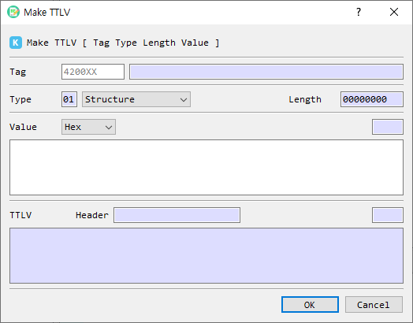

# Make TTLV

The **Make TTLV** dialog builds one TTLV item from its tag, type, and value, and displays the resulting encoded message.

## Fields and controls

| Control | Description |
|---|---|
| Tag | Enter a KMIP tag as hexadecimal text. Enter all 6 hex digits for the 3-byte tag. |
| Tag name | Shows the recognized name for a known tag. |
| Type | Selects the TTLV type, such as Structure, Integer, TextString, or ByteString. |
| Length | Displays the value length in bytes as an 8-digit hexadecimal field. |
| Value format | Chooses how the value text is interpreted (the available data formats are provided by the application). |
| Value | Enter the value in the selected format. |
| Value length | Shows the value length in the selected format. |
| TTLV Header | Shows the encoded tag, type, and length fields. |
| TTLV | Shows the complete encoded item as hexadecimal text, including any required padding. |
| First Set | Checkbox shown in the dialog; its behavior is not described here because it is not connected to an action in the current implementation. |
| OK | Validates and accepts the constructed item. |
| Cancel | Closes the dialog without accepting the item. |

## Create a TTLV item

1. Enter the 6-digit hexadecimal tag. For a recognized KMIP tag, its name appears beside the field.
2. Choose the TTLV **Type**.
3. Choose a value format and enter the value. For a **Structure**, enter no value or provide a valid TTLV-encoded value.
4. Review the automatically updated header and complete TTLV output.
5. Select **OK** to accept the item.

TTLV values are padded with zero bytes to an 8-byte boundary in the encoded output. The header length reflects the unpadded value length. A tag shorter than 6 digits or invalid Structure content prevents acceptance.
