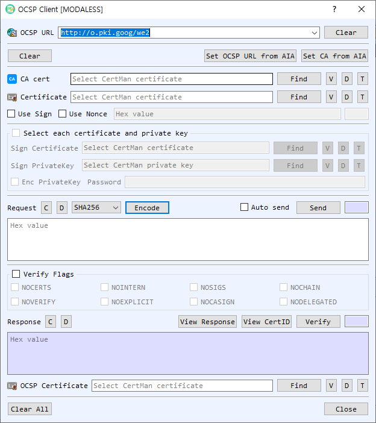

# OCSP Client Dialog Guide

The **OCSP Client** creates an Online Certificate Status Protocol request, sends it to a responder, and verifies the returned response. It can include a nonce and optionally sign the request.

*Figure 1. OCSP Client dialog. Configure the responder and target certificate, encode or send a request, then verify the response.*

## Screen Areas

1. **OCSP URL** — Enter or select the responder URL. Previously used URLs are retained. **Clear** clears the URL history/input.
2. **Set OCSP URL from AIA / Set CA from AIA** — Read the responder URL or issuer CA certificate from the target certificate's Authority Information Access information.
3. **CA cert** — Select the issuer CA certificate. **Find** browses for a certificate; **V**, **D**, and **T** view, decode, and identify it.
4. **Certificate** — Select the certificate whose status is being checked. The dialog can also obtain it from CertMan. The adjacent **Find**, **V**, **D**, and **T** controls select, view, decode, or identify the certificate.
5. **Use Sign / Use Nonce** — Optionally sign the OCSP request with a signing certificate/private key and include a nonce. The signing certificate and key can be selected from CertMan or from individual files; enable **Enc PrivateKey** and enter its password for a protected key. The nonce value is hexadecimal.
6. **Request** — **Encode** builds the OCSP request. **Auto send** sends it immediately after encoding; otherwise use **Send**. **C** clears the request and **D** decodes it in BerEditor.
7. **Verify Flags** — Enable the flag group and select any applicable response-checking flags: `NOCHAIN`, `NOSIGS`, `NOINTERN`, `NOCERTS`, `NOVERIFY`, `NOEXPLICIT`, `NOCASIGN`, or `NODELEGATED`.
8. **Response** — Displays the responder response in hexadecimal. **View Response** opens response details; **View CertID** inspects the certificate identifier; **Verify** validates the response. **C** clears the response and **D** decodes it.
9. **OCSP Certificate** — Select the responder certificate when needed for response verification. **Find**, **V**, **D**, and **T** select or inspect it.
10. **Clear All / Close** — Clear dialog data or close the client.

## Create and Send a Status Request

1. Enter the **OCSP URL** or select **Set OCSP URL from AIA** after choosing a target certificate.
2. Select the target **Certificate**. Provide its **CA cert** or use **Set CA from AIA** where available.
3. Optionally enable **Use Nonce** and enter a hexadecimal nonce. Enable **Use Sign** and select signing credentials if the responder requires signed requests.
4. Select **Encode**. Enable **Auto send** to transmit immediately, or select **Send** after reviewing the encoded request.
5. The response is placed in the **Response** area when the HTTP request succeeds.

## Verify a Response

1. Select the relevant responder certificate if needed.
2. Configure **Verify Flags** according to the verification requirements.
3. Select **Verify** and review the result in BerEditor's message/log area. Use **View Response** and **View CertID** to inspect details.

## Notes

- The CA certificate identifies the issuer of the certificate being checked; the OCSP responder certificate is used to verify the signed response. These may be different certificates.
- Request signing is optional and is separate from the responder's response signature.
- A successful HTTP send only confirms the responder returned data. Use **Verify** to validate the OCSP response before relying on its status.
