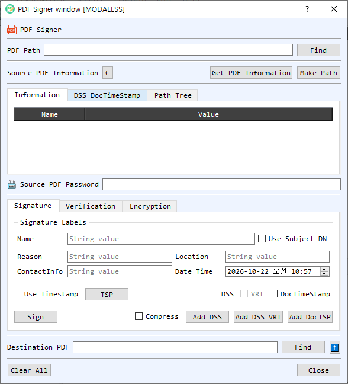

# PDF Signer Dialog Guide

The **PDF Signer** signs and verifies PDF documents, adds document security and timestamp information, builds certificate paths, and encrypts or decrypts PDF files.

*Figure 1. PDF Signer with the Information tab and Signature controls visible. Use the Verification and Encryption tabs for their respective operations.*

## Screen Areas

1. **PDF Path / Find** — Select the source PDF. **Get PDF Information** reads document metadata and signature information; **C** clears the displayed source information.
2. **Source PDF Information tabs** — **Information** lists PDF properties; **DSS DocTimeStamp** shows document security store and document timestamp details; **Path Tree** displays certificate-path information. **Make Path** builds a path for the signing/verification certificate.
3. **Source PDF Password** — Enter the password when the source PDF is encrypted.
4. **Signature tab** — Set signature labels: **Name**, **Reason**, **Location**, **ContactInfo**, and **Date Time**. Enable **Use Subject DN** to use the certificate subject as the signer name.
5. **Timestamp and DSS options** — Enable **Use Timestamp** and configure **TSP** to request a signature timestamp. **DSS** adds validation data; **VRI** adds per-signature validation-related information when DSS is enabled. **DocTimeStamp** adds a document timestamp.
6. **Sign / Compress / DSS buttons** — **Sign** creates the PDF signature. **Compress** controls compression where supported. **Add DSS**, **Add DSS VRI**, and **Add DocTSP** add validation or timestamp data to a PDF.
7. **Verification tab** — Configure certificate verification using the certificate, Trust List, CA List, and optional **At Time** setting. Use **Verify Chain** and the DSS, VRI, or document-timestamp verification controls to inspect the relevant PDF validation data.
8. **Encryption tab** — Use **Encrypt** or **Decrypt** for PDF encryption operations. Provide the required passwords and destination as prompted.
9. **Destination PDF / Find / up-arrow** — Choose the output PDF path. **Find** browses for a destination; the up-arrow copies the source path into the destination field.
10. **Clear All / Close** — Clear the dialog's paths and information or close it.

## Sign a PDF

1. Select a source PDF with **Find** and enter its password if it is encrypted.
2. Select the signing certificate and private key through CertMan when prompted.
3. Set the signature labels and date/time. Enable **Use Subject DN** if the signer name should come from the certificate.
4. Optionally enable **Use Timestamp** and configure the TSP. Select **DSS**, **VRI**, or **DocTimeStamp** if the PDF should include validation or timestamp data.
5. Choose a destination PDF path and select **Sign**. If the destination already exists, confirm whether to replace it.

## Verify a PDF Signature

1. Select the signed PDF and enter its password if required.
2. Review its signature information with **Get PDF Information** and inspect signer/CMS data as needed.
3. On the **Verification** tab, set the certificate and trust options. Use **At Time** to check against a specific time.
4. Select **Verify** for the signature, **Verify Chain** for certificate-chain validation, and the DSS/VRI or DocTSP verification commands when you need to verify embedded validation/timestamp data.
5. Review the verification results and certificate path information.

## Add DSS or Document Timestamp Data

- Select the source PDF and build the certificate path if needed.
- Use **Add DSS** to add validation material, **Add DSS VRI** to add VRI-related material, or **Add DocTSP** to add a document timestamp.
- Specify the output PDF destination and inspect the updated information on the **DSS DocTimeStamp** tab.

## Encrypt or Decrypt a PDF

1. Select the source PDF and provide its password if it is already encrypted.
2. Open the **Encryption** tab and choose **Encrypt** or **Decrypt**.
3. Provide the required credentials and destination path, then run the selected operation.

## Notes

- PDF signing changes the document and creates a signed output file. Keep the original if you need an unchanged copy.
- A valid signature does not by itself guarantee that the signer certificate chains to a trusted authority; review signature and chain verification separately.
- Timestamping depends on the configured TSP service. DSS and VRI features depend on the validation information available for the signing certificate.
- Protect PDF passwords and signing private keys. Verification results depend on the chosen trust sources and verification time.
