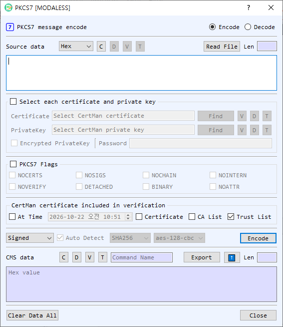

# PKCS7 Dialog Guide

The **PKCS7** dialog creates and processes PKCS#7/CMS messages. It supports data and digest containers, signing and signature verification, and enveloped-data encryption and decryption.

*Figure 1. PKCS7 dialog in Encode mode. Select Encode or Decode at the top; the available command and controls change with the selected mode.*

## Screen Areas

1. **Encode / Decode** — Choose whether to create a PKCS7/CMS message or process an existing one. The source and output labels change to reflect the mode.
2. **Source Data / CMS data** — Enter source content or the CMS message. Choose **Hex**, **String**, or **Base64** for the source representation. **Read File** loads a file; files can also be dragged into the dialog. In Decode mode, **V**, **D**, and **T** view, decode, and identify the source object. **C** clears the source.
3. **Select each certificate and private key** — Enable this group to select certificate and private-key files directly. **Find** browses for a file; **V**, **D**, and **T** view details, decode the file in BerEditor, and show its type. Enable **Encrypted PrivateKey** and enter its password when the private key is password protected.
4. **PKCS7 Flags** — Enable the group to apply operation flags. The available flags are `NOCERTS`, `NOSIGS`, `NOCHAIN`, `NOINTERN`, `NOVERIFY`, `DETACHED`, `BINARY`, and `NOATTR`. Their effect depends on the selected command.
5. **Verification options** — In the certificate verification area, choose whether to validate **At Time** (using the adjacent date/time), include a selected **Certificate**, use the **CA List**, or use the **Trust List**. These options are used for signature verification; the default screen has **Trust List** enabled.
6. **Hash and cipher** — Select a hash algorithm for signing-related operations and an AES-CBC cipher (**aes-128-cbc**, **aes-192-cbc**, or **aes-256-cbc**) for enveloped-data operations. Controls are enabled when relevant to the selected command.
7. **Command and Auto Detect** — Choose an operation. In Decode mode, **Auto Detect** identifies the CMS type and dispatches to the matching decode/verify operation. Turn it off to choose a decode command manually.
8. **Run button** — Executes the selected command. It is labeled **Encode** or **Decode** according to the mode.
9. **CMS data / Source data output** — Displays the result and its length. The output representation selector and **⬆** transfer button let you reuse the result as input. **Export** saves the output. **V**, **D**, and **T** view, decode, and identify the output; **C** clears it. For encoded output, the command name is shown beside the controls.
10. **Clear Data All / Close** — Clear the dialog's values or close it.

## Create a PKCS7/CMS Message

1. Select **Encode** and enter content in **Source Data**, or load it with **Read File**.
2. Select an encoding command:
   - **Data** wraps content in a CMS Data object.
   - **Digest** creates a CMS DigestedData object using the selected hash.
   - **Signed** creates a signed message. Select the signing certificate and private key.
   - **Enveloped** encrypts the content for the selected recipient certificate. Choose an AES-CBC cipher.
   - **Add Signed** adds a signer to an existing SignedData message; choose the hash and provide the signing certificate and private key.
3. Set any applicable flags and options.
4. Select **Encode**. The CMS message appears in the output area. Use **Export** to save it.

## Decode, Verify, or Decrypt a Message

1. Select **Decode** and provide the CMS data. Use **Read File** or drag a file into the dialog if convenient.
2. Leave **Auto Detect** enabled to process supported Data, DigestedData, SignedData, or EnvelopedData according to its type. To choose explicitly, turn off **Auto Detect** and select **Verify**, **Developed**, **GetData**, or **GetDigest**.
3. For **Verify**, configure the certificate and trust/CA/time options as needed. For **Developed** (decryption of EnvelopedData), select the recipient certificate and matching private key. Enter the private-key password if required.
4. Select **Decode**. Extracted data, digest data, verification results, or decrypted content is shown in the output area or reported by the dialog.

## PKCS7 Flags

| Flag | Purpose |
| --- | --- |
| `NOCERTS` | Omit signer certificates when creating signed data. |
| `NOSIGS` | Skip signature verification. |
| `NOCHAIN` | Disable certificate-chain verification. |
| `NOINTERN` | Do not search certificates embedded in the message. |
| `NOVERIFY` | Skip signer-certificate verification. |
| `DETACHED` | Create or process detached signed data, where content is separate from the CMS structure. |
| `BINARY` | Treat content as binary data. |
| `NOATTR` | Omit signed attributes when creating signed data. |

## Notes

- The available command list depends on Encode or Decode mode. Decode Auto Detect supports CMS Data, DigestedData, SignedData, and EnvelopedData types.
- Signed and enveloped operations require the appropriate signing or recipient credentials. The certificate and private key must match, and encrypted private-key files require their password.
- The source representation selector controls how input text is interpreted. The output's **T** control identifies the CMS type; the displayed output itself is represented using the output format controls.
- Verification depends on the selected certificate and trust settings. Review the verification result before relying on a signed message.
