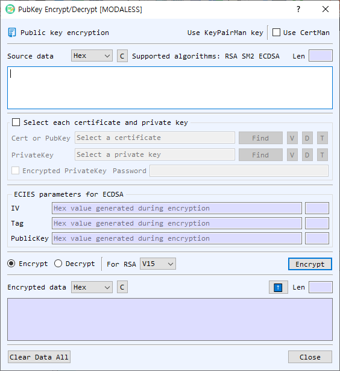

# Public-Key Encrypt/Decrypt Dialog Guide

The **Public-Key Encrypt/Decrypt** dialog encrypts data with a public key and decrypts it with the matching private key. It supports RSA, SM2, and ECDSA-based ECIES operations.

*Figure 1. Public-Key Encrypt/Decrypt dialog. Choose an operation, provide the data and corresponding key, then run it to view the result.*

## Screen Areas

1. **Input Data** — Enter the plaintext to encrypt or ciphertext to decrypt. Select its representation as **Hex**, **String**, or **Base64**. The dialog shows the input length; **C** clears the input.
2. **Supported algorithms** — RSA, SM2, and ECDSA. For ECDSA, this dialog uses ECIES encryption and decryption.
3. **Key source** — Use a key managed by **KeyPairMan** or enable **Use CertMan** to choose certificate/key material from CertMan. The required key depends on the selected operation.
4. **Select each certificate and private key** — Enable this option to specify a certificate or public-key file and a private-key file directly. Use **Find** to browse for a file. The adjacent **V**, **D**, and **T** controls view information, decode the file in the main BerEditor window, and show the key type, respectively.
5. **Encrypted PrivateKey / Password** — Enable this when the selected private-key file is password protected, then enter its password. This applies when reading the private key for decryption.
6. **ECIES parameters** — **IV**, **Tag**, and the other **PublicKey** value carry the ECIES parameters. On encryption, the dialog generates these values; on decryption, provide the values associated with the ciphertext. Values are hexadecimal.
7. **Encrypt / Decrypt** — Select the operation. Encryption uses a public key; decryption uses the matching private key.
8. **RSA scheme** — Choose **V15** or **OAEP** for RSA. This setting does not select an SM2 or ECIES mode.
9. **Encrypt / Decrypt button** — Runs the selected operation. The button label follows the selected mode.
10. **Output Data** — Displays the result in the selected output representation (**Hex**, **String**, or **Base64**) and shows its length. **C** clears the result. The up-arrow copies the result into Input Data and sets the input representation to match the output.
11. **Clear Data All** — Clears the dialog's data and related values. **Close** closes the dialog.

## Encrypt Data

1. Select **Encrypt**.
2. Enter the plaintext in **Input Data** and choose its representation.
3. Choose the public key or certificate source. If using individual files, enable **Select each certificate and private key** and select the certificate or public-key file.
4. For RSA, select **V15** or **OAEP**. For SM2 or ECDSA, use the appropriate public key; RSA scheme selection does not apply.
5. Select **Encrypt**. The encrypted result appears in **Output Data**.
6. For ECIES, record the generated **IV**, **Tag**, and other **PublicKey** value along with the ciphertext. Decryption requires these parameters.

## Decrypt Data

1. Select **Decrypt**.
2. Enter the ciphertext and choose its representation.
3. Select the corresponding private key. If it is password protected, enable **Encrypted PrivateKey** and enter the password.
4. For RSA, select the same padding scheme used to encrypt the data. For ECIES, enter the associated **IV**, **Tag**, and other **PublicKey** values in hexadecimal.
5. Select **Decrypt**. The plaintext appears in **Output Data**.

## Notes

- Encryption and decryption must use a matching public/private key pair and compatible algorithm parameters.
- Keep the ECIES parameters with the ciphertext; the ciphertext alone is insufficient for this dialog's ECIES decryption workflow.
- The output representation controls how the result is displayed, not the cryptographic operation. Use the up-arrow to pass a result back as input.
- The dialog warns when input data, a required key, or a required password is missing, or when the selected data cannot be decoded in the chosen representation.
