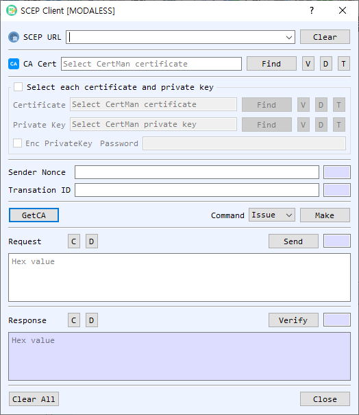

# SCEP Client Dialog Guide

The **SCEP Client** creates and sends Simple Certificate Enrollment Protocol requests to a CA. It supports certificate **Issue**, **Update**, and **GetCRL** operations, plus retrieval of the CA certificate.

*Figure 1. SCEP Client dialog with Issue selected. Use GetCA to retrieve CA certificate information, then create and send the selected request.*

## Screen Areas

1. **SCEP URL** — Enter or select the SCEP endpoint. **Clear** clears the saved URL list/input.
2. **CA Cert / GetCA** — Select a CA certificate with **Find**, or use **GetCA** to retrieve the CA certificate from the SCEP server. **V**, **D**, and **T** view, decode, or identify it.
3. **Select each certificate and private key** — Enable this group to select client certificate/private-key files directly. Otherwise, use CertMan. Enable **Enc PrivateKey** and enter the password for an encrypted key.
4. **Sender Nonce / Transaction ID** — View or enter the SCEP sender nonce and transaction identifier used to correlate requests and responses.
5. **Command / Make** — Choose **Issue**, **Update**, or **GetCRL**, then select **Make** to build the corresponding request.
6. **Request** — Displays the request in hexadecimal. **Send** transmits it to the SCEP endpoint. **C** clears and **D** decodes the request.
7. **Response / Verify** — Displays the server response. **Verify** checks the SCEP response; **C** clears and **D** decodes it.
8. **Clear All / Close** — Clear dialog data or close the client.

## Issue a Certificate

1. Enter the SCEP URL and select the CA certificate. Use **GetCA** if you need to retrieve the CA certificate from the server.
2. Select **Issue** and choose **Make**. The client opens key-pair and CSR dialogs to create enrollment material and prepares the SCEP request.
3. Select **Send** to submit the request. Review the response and choose whether to save issued certificate and key material when prompted.

## Update a Certificate or Retrieve a CRL

1. Enter the SCEP URL and select the CA certificate.
2. Select **Update** or **GetCRL**. Provide the existing certificate and private key when requested.
3. Select **Make**, then **Send** to submit the generated request.
4. Use **Verify** to check the response and **D** to inspect its encoded contents.

## Notes

- **Issue** creates new key/CSR material as part of request preparation. **Update** and **GetCRL** use existing certificate/key context.
- Keep sender nonce and transaction ID associated with their request/response exchange.
- Protect private-key passwords and enrollment credentials. Confirm the server response before using newly issued credentials.
