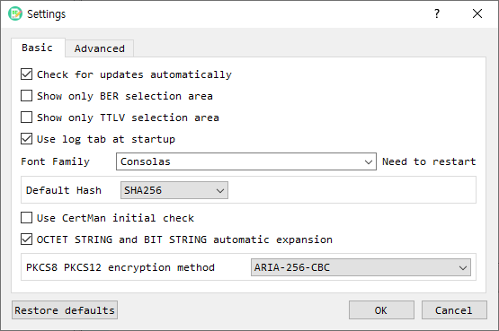

# Settings

The **Settings** dialog controls BerEditor display, parsing, language, and file-related preferences. Some advanced options are available only in the licensed version.

## Basic tab

| Setting | Description |
|---|---|
| Check for updates automatically | Enables automatic update checks when the build supports them. |
| Show only BER selection area | Limits the main window to the BER selection area. |
| Show only TTLV selection area | Limits the main window to the TTLV selection area. |
| Use log tab at startup | Shows the log tab when BerEditor starts. |
| Font Family | Selects the monospaced font used by the application. The dialog indicates that a restart is needed. |
| Default Hash | Sets the initial hash choice used by applicable cryptographic dialogs. |
| Use CertMan initial check | Controls the initial CertMan selection behavior. |
| OCTET STRING and BIT STRING automatic expansion | Enables automatic expansion of these BER values in the decode view. |
| PKCS8 PKCS12 encryption method | Selects the encryption method used for PKCS#8 and PKCS#12 operations. |

## Advanced tab

| Setting | Description |
|---|---|
| OID Config File | Path to the OID configuration file. Use **Find** to select a file. |
| File Read Size | Size of each read operation when reading a file. |
| Certificate Path | Certificate storage path. **Find** selects a base folder; BerEditor appends its `JSPKI` subfolder. |
| Language | Selects the application language. The setting requires a restart to take effect. |
| Support for changing original keypair | Enables support for changing the original key pair. |
| Use fixed hex and bit value area / Characters | Sets the fixed width of the hexadecimal and bit-value display area. |
| Automatic online import when creating CA and CRL paths | Enables automatic online import during CA and CRL path creation. |

Some advanced settings are disabled in unlicensed mode.

## Apply or restore settings

1. Choose the **Basic** or **Advanced** tab and change the required options.
2. Select **OK** to save the changes. If you changed the language, accept the restart prompt to apply it.
3. Select **Cancel** to discard edits in the dialog.
4. Select **Restore defaults** to clear saved settings. Confirm the prompt; BerEditor may offer to restart.
