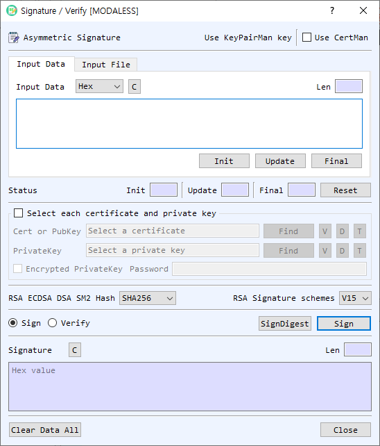

# Signature / Verify Dialog Guide

The **Signature / Verify** dialog creates or verifies an asymmetric digital signature using input data or a file. Open it from **Cryptography > Sign/Verify**.

*Figure 1. Signature / Verify dialog. Select the data, signing key or verification certificate, algorithm options, and operation.*

## Screen Areas

1. **Use KeyPairMan key / Use CertMan** — Select the key source used when the individual certificate/private-key file group is not enabled. The selected manager provides the required key or certificate.
2. **Input Data / Input File** — Enter message data directly or select a file to sign or verify.
3. **Input Type / Input area** — Select the representation (such as Hex, String, or Base64), enter the data, and review the calculated length. In file mode, use **Find** and monitor file information and progress.
4. **Init / Update / Final / Reset** — Perform signing or verification incrementally. Initialize with the chosen key, feed data blocks with Update, and complete the operation with Final.
5. **Select each certificate and private key** — Enable this group to select the key material from files rather than a key manager.
6. **Cert or PubKey** — Select a certificate or public key for verification. **Find** selects the file; **V** opens its details; **D** decodes it in BerEditor; **T** reports its key type.
7. **PrivateKey** — Select the private key for signing. **Find**, **V**, **D**, and **T** provide file selection, details, BER decoding, and key-type information.
8. **Encrypted PrivateKey / Password** — Select this when the private-key file is encrypted, then enter its password.
9. **Hash** — Select a hash for RSA, ECDSA, DSA, and SM2 signatures. SM2 requires SM3.
10. **RSA Signature schemes** — Select the RSA signature scheme, such as V15 or PSS, when signing or verifying with RSA.
11. **Sign / Verify** — Select the operation. The run button changes to **Sign** or **Verify**.
12. **SignDigest** — Signs or verifies an already-computed digest. The input must have the selected hash's digest length; the dialog warns if the lengths differ.
13. **Signature** — Displays the generated signature in Hex when signing. For verification, enter the expected signature here as hexadecimal. The length is shown beside it.
14. **Clear Data All / Close** — Clears input, key paths, signature and status, or closes the dialog.

## Sign a Message

1. Select **Input Data** or **Input File** and provide the message.
2. Select **Sign**.
3. Choose a private key source:
   - Use **KeyPairMan key** or **CertMan** from the top controls; or
   - Enable **Select each certificate and private key**, then select a private key file. If it is encrypted, enable **Encrypted PrivateKey** and enter its password.
4. Select the hash algorithm. For RSA, choose the RSA signature scheme as appropriate.
5. Select **Sign**. The signature is displayed in hexadecimal.

## Verify a Signature

1. Provide the same message data or file that was signed.
2. Select **Verify**.
3. Choose the public key source: a certificate or public key from the key manager, CertMan, or the file selection group.
4. Choose the matching hash and RSA signature scheme.
5. Enter the expected signature in the **Signature** field as hexadecimal.
6. Select **Verify** and read the success or failure message.

## Sign or Verify a Digest

Select **SignDigest** to operate directly on a precomputed digest rather than hashing a message through the normal Sign/Verify path. Enter the digest in the input area using the selected input representation. The dialog checks its length against the selected hash and asks whether to continue if they differ.

## Incremental Operations and Notes

- Use **Init**, **Update**, and **Final** to process data in stages. Select **Reset** before starting another staged operation.
- The same message bytes, key pair, hash, and RSA signature scheme must be used for successful verification.
- SM2 uses SM3. If another hash is selected, BerEditor prompts to switch to SM3.
- Some key algorithms do not support the staged Init/Update/Final workflow. Use the one-shot **Sign** or **Verify** action when prompted.
