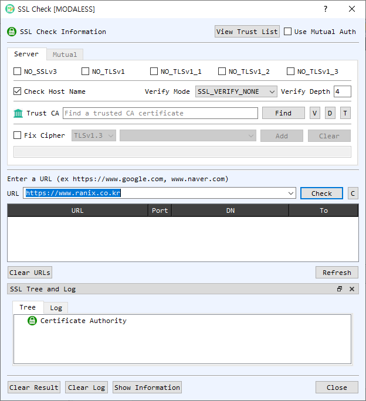

# SSL Check Dialog Guide

The **SSL Check** dialog connects to an HTTPS server and reports TLS, certificate, and trust information. It can also test servers that require mutual TLS client authentication.

*Figure 1. SSL Check dialog on the Server tab. Enter a server URL and select Check to test the TLS connection and certificate chain.*

## Screen Areas

1. **Server / Mutual tabs** — Configure ordinary server checks on **Server**. Use **Mutual** to configure a client certificate and private key for mutual TLS.
2. **View Trust List / Use Mutual Auth** — Open CertMan's trusted root list or enable client-certificate authentication.
3. **Protocol options** — Check `NO_SSLv3`, `NO_TLSv1`, `NO_TLSv1_1`, `NO_TLSv1_2`, and `NO_TLSv1_3` to disable the corresponding protocol versions for the test connection.
4. **Check Host Name** — Enable hostname verification so the server certificate is checked against the requested host.
5. **Verify Mode / Verify Depth** — Set the TLS certificate verification mode and maximum chain depth. The displayed default depth is 4.
6. **Trust CA** — Optionally select a trusted CA certificate file with **Find**. **V**, **D**, and **T** view, decode, and identify the selected file.
7. **Fix Cipher** — Enable a restricted cipher configuration, choose a TLS version and cipher, and select **Add**. **Clear** removes the configured cipher selection.
8. **URL / Check** — Enter a hostname or URL and select **Check**. If no scheme is supplied, the dialog assumes `https://`; the default port is 443. **C** clears the URL field.
9. **Results table** — Lists tested URL, port, certificate distinguished name, and expiry. Select or right-click a row for available certificate actions, including viewing, decoding, or checking it again.
10. **Clear URLs / Refresh** — Clear the current result list or rerun checks for the saved URLs.
11. **SSL Tree and Log** — **Tree** displays certificate authority/path information; **Log** shows connection and verification details. **Clear Result** clears results; **Clear Log** clears the log.
12. **Show Information / Close** — Opens the selected server's SSL information window or closes the dialog.

## Check an HTTPS Server

1. On the **Server** tab, configure protocol versions, hostname checking, verification mode, and verification depth as needed.
2. Optionally select a **Trust CA** certificate or use the configured trust list.
3. Enter a URL such as `https://example.com`, or a hostname such as `example.com`.
4. Select **Check**. Review the result table, certificate tree, and log for connection and chain status.
5. Select **Show Information** to inspect details for the selected result. Use **Refresh** to check saved URLs again.

## Check a Mutual TLS Server

1. Enable **Use Mutual Auth** and open the **Mutual** tab.
2. Provide the client CA certificate and select a client certificate/private-key pair, either from CertMan or with the individual certificate and private-key file controls.
3. If the private key is encrypted, enable **Encrypted PrivateKey** and enter its password.
4. Return to the server check and select **Check**. The client credentials are presented during the TLS handshake.

## Notes

- The URL check tests the live server connection using the current network, TLS, hostname, and trust settings. A server's configuration and certificate status can change over time.
- Disabling protocol versions or restricting ciphers changes the handshake options and may prevent connection to servers that do not support the remaining choices.
- Mutual TLS requires a client certificate and its matching private key. Keep private-key files and passwords confidential.
- A successful TLS connection and certificate verification are distinct from application-level security or the server's identity beyond the selected verification checks.
