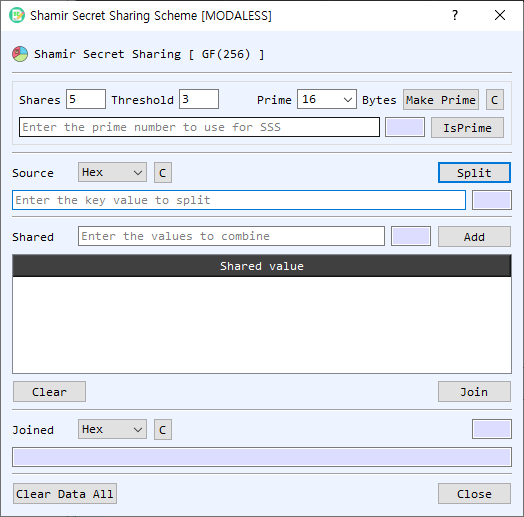

# Shamir Secret Sharing Dialog Guide

The **Shamir Secret Sharing [GF(256)]** dialog splits a secret into shares and reconstructs it from a threshold number of shares. Use the same prime value and threshold settings when splitting and joining.

*Figure 1. Shamir Secret Sharing dialog. The upper section splits a source value into shares; the lower section combines selected shares to reconstruct the value.*

## Screen Areas

1. **Shares** — Number of shares to create. The default is `5`.
2. **Threshold** — Minimum number of shares required to reconstruct the secret. The default is `3`.
3. **Prime** — Prime value used by the sharing operation, entered as hexadecimal. The selected **Bytes** value sets the size for **Make Prime**; available choices are 8, 16, 32, 64, 128, and 256 bytes. **C** clears the prime. **IsPrime** checks whether the entered value is prime.
4. **Source** — Secret value to split. Select its input representation (**Hex**, **String**, or **Base64**), enter the value, and select **Split**. **C** clears the source; the adjacent field shows its length.
5. **Shared** — Enter a share value in hexadecimal and select **Add** to append it to the share list. The adjacent field displays its length.
6. **Shared value list** — Shows the shares available for reconstruction. Right-click a row to copy or delete it. **Clear** removes all listed shares.
7. **Join** — Reconstructs the original secret from the listed shares using the configured threshold and prime.
8. **Joined** — Displays the reconstructed value using the selected representation (**Hex**, **String**, or **Base64**). **C** clears the result; the adjacent field shows its length.
9. **Clear Data All / Close** — Clears the values and share list, or closes the dialog.

## Split a Secret

1. Set **Shares** to the total number of shares to generate and **Threshold** to the minimum number needed to reconstruct the secret.
2. Enter a prime in **Prime**, or choose a byte size and select **Make Prime**. Use **IsPrime** to check a manually entered value.
3. Enter the secret in **Source** and select its representation.
4. Select **Split**. The generated share values appear in the list. Save or copy the shares and keep the threshold and prime information available for reconstruction.

## Join Shares

1. Enter the same **Prime** and **Threshold** used for splitting.
2. Add share values to the **Shared** field one at a time, selecting **Add** after each. Shares must be hexadecimal values.
3. Add at least the threshold number of shares, then select **Join**.
4. Read the reconstructed secret in **Joined** and choose the desired output representation.

## Notes

- The prime must be greater than the source value. An insufficient prime causes the split operation to fail.
- Reconstruction requires at least the configured threshold number of shares; the dialog also requires at least two shares in the list.
- Duplicate shares are rejected when adding them. Use the share list's right-click menu to copy or remove a share.
- Shares and the original secret are sensitive. Store shares separately and clear the dialog when finished.
