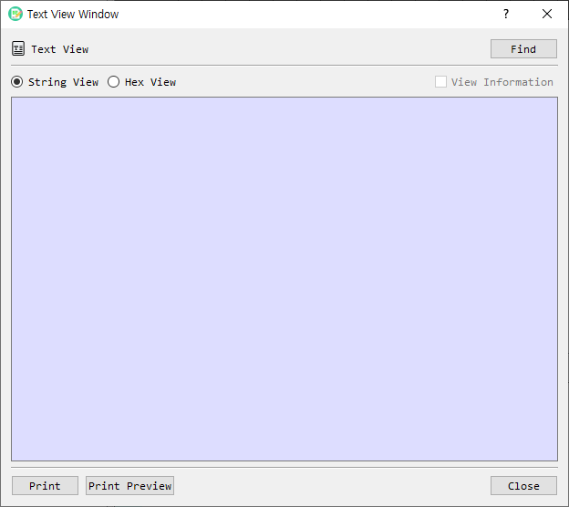

# Text View Dialog Guide

The **Text View** dialog presents decoded BER or KMIP TTLV data as an indented text listing, or shows its hexadecimal values. Open it from **Tool > Text View**.

*Figure 1. Text View dialog. String View is selected by default; choose Hex View to inspect encoded bytes.*

## Screen Areas

1. **Find** — Loads a binary file to view. BerEditor parses it as BER or, when detected, KMIP TTLV.
2. **String View** — Displays parsed fields and values in an indented text layout. This is the default view.
3. **Hex View** — Displays parsed structures and their hexadecimal bytes.
4. **View Information** — Adds an ASCII/printable-text column in Hex View. This option is available only in Hex View and is disabled for String View.
5. **Output area** — Shows the listing. It is read-only and does not wrap long lines.
6. **Print / Print Preview** — Prints the displayed listing or previews it before printing.
7. **Close** — Closes the dialog.

## View Data

1. Open Text View from the selected data in BerEditor, or select **Find** to load a file.
2. Choose **String View** or **Hex View**.
3. In Hex View, optionally select **View Information** to show printable characters alongside hexadecimal bytes.
4. Scroll through the parsed output. Use **Print** or **Print Preview** if needed.

The viewer detects KMIP TTLV data and displays its parsed structure. Otherwise, it parses the input as BER. You can also drag and drop a local file onto the dialog.

## View Modes

- **String View** focuses on decoded values and structure. The information-column option is unavailable in this mode.
- **Hex View** shows bytes in groups of up to 16, with offsets and structural indentation. Enable **View Information** to include printable text beside the bytes.
- The view area is read-only; use the main BerEditor tools to edit or construct data.
