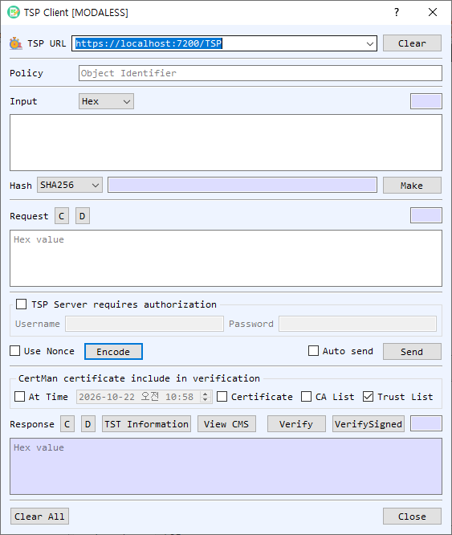

# TSP Client Dialog Guide

The **TSP Client** creates Time-Stamp Protocol requests, sends them to a timestamp authority, and verifies the returned timestamp token and signature.

*Figure 1. TSP Client dialog. Hash the data, create and send a timestamp request, then verify the token returned by the TSA.*

## Screen Areas

1. **TSP URL** — Enter or select the timestamp authority URL. **Clear** clears the URL list/input.
2. **Policy** — Optionally enter the requested timestamp policy OID.
3. **Input** — Enter the data to timestamp and select its representation (**Hex**, **String**, or **Base64**). The adjacent field shows its length.
4. **Hash / Make** — Choose a hash algorithm and select **Make** to calculate the digest of the input. The digest appears beside the button.
5. **Request** — **Encode** creates a TSP request using the input, selected hash, optional policy, and nonce setting. **C** clears the request; **D** decodes it.
6. **TSP Server requires authorization** — Enable this group and enter the server's **Username** and **Password** for HTTP Basic authentication.
7. **Use Nonce / Auto send / Send** — Include a nonce in the request, transmit automatically after encoding, or send the current request manually.
8. **Certificate included in verification** — Configure **At Time**, **Certificate**, **CA List**, and **Trust List** for response verification. The default screen has **Trust List** enabled.
9. **Response** — Displays the timestamp response in hexadecimal. **TST Information** displays the parsed timestamp information; **View CMS** inspects the CMS token; **Verify** validates the response; **VerifySigned** checks the signed token. **C** clears and **D** decodes the response.
10. **Clear All / Close** — Clear dialog data or close the client.

## Request a Timestamp

1. Enter the source data in **Input** and choose its representation.
2. Select a **Hash** and choose **Make** to compute the digest. The request is built from the data and selected hash.
3. Optionally enter a **Policy** OID, enable **Use Nonce**, and provide server credentials if authorization is required.
4. Select **Encode**. Enable **Auto send** to transmit immediately, or choose **Send** manually.
5. Review the returned response in the **Response** area.

## Verify the Timestamp

1. Select the certificate verification options: **Trust List**, **CA List**, an optional **Certificate**, and **At Time** if checking at a specific date/time.
2. Select **Verify** to validate the timestamp response and **VerifySigned** to verify the signed token as needed.
3. Use **TST Information** or **View CMS** to inspect the token contents.

## Notes

- The source data's digest is sent in the request; the original data itself is not included in a standard timestamp request.
- The selected hash and policy must be supported by the timestamp authority.
- Successful transmission does not establish that a token is valid. Review the verification result and trust settings.
