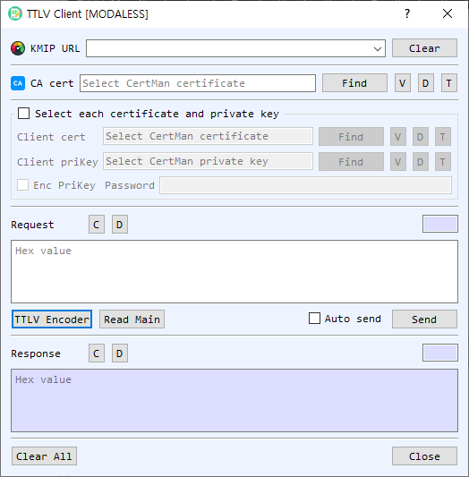

# TTLV Client

The **TTLV Client** sends a hexadecimal KMIP TTLV request to a server and displays the hexadecimal response.

## Connection and TLS fields

| Control | Description |
|---|---|
| KMIP URL | Server address. Previously used URLs are available in the editable list. |
| Clear (URL) | Clears the saved URL history and the current URL entry. |
| CA Cert | CA certificate used to verify the server for TLS. **Find** selects a certificate file. The adjacent **V**, **D**, and **T** controls view, decode, or identify the certificate. |
| Client certificate and private key | Optional client identity fields. Enable the certificate/key group to select files directly; otherwise the client can prompt you to select them from CertMan. |
| Encrypted PrivateKey / Password | Enable this option and enter the password when the selected client private key is encrypted. |

For `https` or `ssl` URLs, the client establishes TLS and uses the CA certificate. Client certificate and private key selection supports mutual TLS when required by the server. For other URL schemes, it uses a plain socket connection.

## Request and response

| Control | Description |
|---|---|
| Request | Hexadecimal TTLV bytes to send. The length is displayed with the request. |
| C / D (Request) | Clear the request / decode it in the main BerEditor view. |
| TTLV Encoder | Opens the request encoder and places an accepted encoded request here. |
| Read Main | Copies TTLV data from the main BerEditor window into the request field. |
| Auto send | Sends a request immediately after accepting it from TTLV Encoder. |
| Send | Connects to the configured server and sends the request. The response is placed in the Response field. |
| Response | Hexadecimal TTLV response returned by the server. |
| C / D (Response) | Clear the response / decode it in the main BerEditor view. |
| Clear All | Clears request and response data. |
| Close | Closes the client dialog. |

## Send a request

1. Enter or select a **KMIP URL**.
2. For TLS, select the **CA Cert**. If the server requests a client identity, select a certificate and private key, or choose them through CertMan. Provide the private-key password if needed.
3. Enter a hexadecimal TTLV request, select **Read Main** to reuse the main-window TTLV data, or use **TTLV Encoder** to create a request.
4. Select **Send**. With **Auto send** enabled, a request created through TTLV Encoder is sent as soon as it is accepted.
5. Review the hexadecimal response. Select **D** to decode a request or response in the main window.

The application saves successfully used URLs in the URL history. Ensure the URL, certificates, and request are appropriate for the KMIP server before sending.
