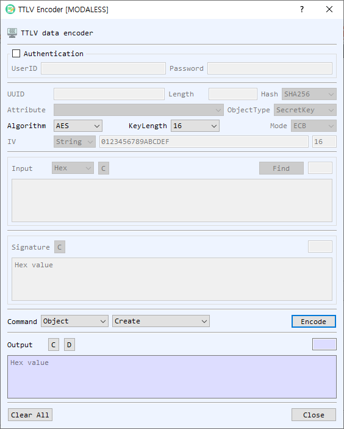

# TTLV Encoder

The **TTLV Encoder** creates a KMIP request by selecting an operation and filling its parameters. The output is a hexadecimal TTLV message.

## Authentication

The **Authentication** group is optional. Enable it to include a KMIP UserID and Password in the request.

## Request parameters

Available parameters depend on the selected operation. The dialog enables the relevant fields.

| Field | Purpose |
|---|---|
| UUID | Object unique identifier used by operations that target an existing object. |
| Length | Length parameter, used by applicable operations such as random number retrieval. |
| Hash | Hash or signature digest selection. The initial selection follows BerEditor's default hash setting. |
| Attribute | Attribute used by attribute operations. |
| ObjectType | Object category such as SecretKey, PrivateKey, PublicKey, or Certificate. |
| Mode | Cryptographic mode, including RSA modes and AES modes where applicable. |
| Algorithm | RSA, ECDSA, or AES. |
| KeyLength / Option | Key size or algorithm-specific option. ECDSA options include P-256, P-384, and P-521; AES sizes are 16, 24, and 32 bytes. |
| IV format / IV | Input format and initialization vector for operations that use an IV. |
| Input format / Input | Data for the selected operation. Choose Hex, String, or Base64; **Find** loads data from a file. |
| Signature | Signature bytes used by Verify. |

## Select an operation

The **Type** selector groups commands:

- **Object:** Create, Activate, Get, Destroy, Register, Locate, Create Key Pair.
- **Cryptography:** Encrypt, Decrypt, Sign, Verify, Hash, RNG Seed, RNG Retrieve.
- **Attribute:** Add Attribute, Get Attributes, Modify Attribute, Get Attribute List, Delete Attribute.

Choose the group and then the command. Fill the fields that become available for that operation. For example, Encrypt and Decrypt use an object UUID and input; Verify also needs a signature; RNG Retrieve uses a length.

## Generate and use output

1. Select a **Type** and command.
2. Enter the operation parameters. Enable **Authentication** and provide credentials if the request requires them.
3. Select **Encode**. The generated TTLV appears in **Output** as hexadecimal text.
4. Use the output decode control to inspect the encoded request in BerEditor's main view. Use **Clear** controls to clear individual input, signature, or output areas; **Clear All** resets the form.
5. Select **OK** to return the generated output when that button is available. In managed mode, the dialog is used as an encoder panel and **OK** is hidden. **Close** exits the dialog.
