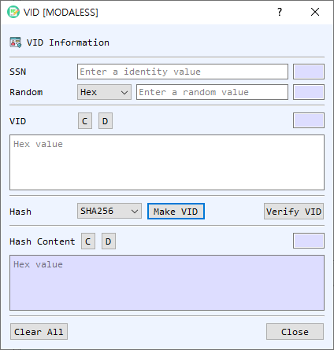

# VID Dialog Guide

The **VID** dialog creates and verifies a VID (Virtual ID) using an identity value, a random value, and a selected hash algorithm. It also displays the associated hash content for inspection.

*Figure 1. VID dialog. Enter the same identity and random value used to create a VID, then generate or verify the value.*

## Screen Areas

1. **SSN** — Enter the identity value used in the VID calculation. The adjacent field displays its length.
2. **Random** — Enter the random value and select its representation (**Hex**, **String**, or **Base64**). The adjacent field displays the decoded length.
3. **VID** — Displays the VID as hexadecimal. **D** decodes the value in BerEditor's main window; **C** clears it. The adjacent field shows the length.
4. **Hash** — Select the hash algorithm used when creating a VID. The initial value follows BerEditor's configured default hash.
5. **Make VID / Verify VID** — Generate a VID and its hash content, or verify the entered VID against the supplied identity and random value.
6. **Hash Content** — Displays the hexadecimal hash content produced during generation or recovered during successful verification. **D** decodes it in BerEditor; **C** clears it. The adjacent field shows the length.
7. **Clear All / Close** — Clear the SSN, random value, VID, and hash content, or close the dialog.

## Create a VID

1. Enter the identity value in **SSN**.
2. Enter the random value and select its representation.
3. Choose the **Hash** algorithm.
4. Select **Make VID**. The generated VID and corresponding Hash Content appear in their fields.

## Verify a VID

1. Enter the same identity value and random value used to create the VID. Select the correct random-value representation.
2. Enter the VID in hexadecimal in the **VID** field.
3. Select **Verify VID**. A successful verification displays the recovered Hash Content and reports the result in BerEditor's message/log area.

## Notes

- Verification requires the original identity value and random value, with the same random-value encoding used when the VID was created.
- The VID field and Hash Content field use hexadecimal values. Use their **D** buttons to inspect the encoded data in BerEditor.
- The dialog records the identity value, random value, hash, hash content, and VID in BerEditor's log during generation. Consider this when handling identifying or sensitive input.
